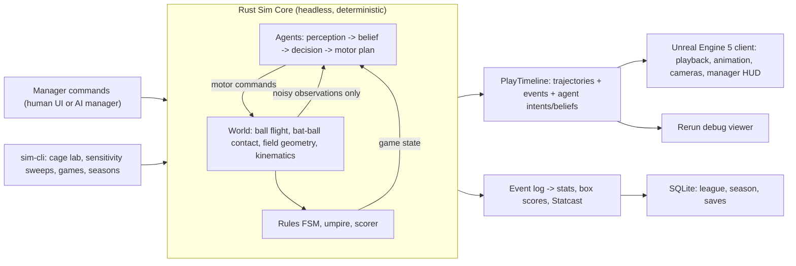

# 3D Physics-Based Baseball Management Game: Master Plan

**Last updated:** 2026-10-31
**Status:** Implementation. M0 (except the Unreal spike), M1, and M2 are done; M3 mechanisms are done with calibration open; the M4 walking skeleton plays full AI-vs-AI games in the CLI. Live status: [TASKS.md](TASKS.md).
**Sources:** [brainstorming note (2026-10-26)](./2026-10-26--physics-based-baseball-game__note.docx) · [Pass 1, Gemini](./docs/archive/PLAN-pass1-gemini.md) · [Pass 2, Claude](./docs/archive/PLAN-pass2-claude.md)

This is the single living plan. It merges Passes 1 and 2 and the owner's answers. The archived passes are kept for history only. Where they disagree with this file, this file wins.

---

## 0. Purpose

> **3D players play baseball, and every outcome comes from their physical and mental attributes, never from statistical or dice rolls.**

The human is the **manager**. They pick lineups, tactics, pitching changes, and positioning while watching the game live in 3D. Autonomous players perceive, decide, and act. Physics resolves what actually happens. Season statistics are an *output* of that process, never a target, and the league does not have to match MLB.

**Working model:** AI agents do the implementation. The owner makes the decisions. Every decision is recorded in §1 so later AI sessions don't re-argue settled questions.

---

## 1. Decision Log

| ID | Decision | Status | Rationale (short) |
| :--- | :--- | :--- | :--- |
| D1 | **No outcome rolls.** Randomness enters only as physical/physiological noise on inputs, and as a player mixing his own choices (which pitch, where), as real players do so they cannot be predicted. Agents may hold probabilistic *beliefs*; the world never consults them and never draws an outcome. | **Decided**; the mixed choices added on the owner's Q29 (a), 2026-11-18 | Core purpose. §4.1 |
| D2 | Headless simulation core, fully separate from presentation | **Decided** | Fast unattended games; engine independence |
| D3 | One simulation for watched and background games; no "quick-sim" approximation | **Decided** | Background results must mean the same thing as live ones |
| D4 | Physics is authoritative; animation conforms to physical trajectories | **Decided** | Purpose |
| D5 | **Sim core language: Rust** | **Decided** (owner delegated "best") | §3 |
| D6 | **Presentation engine: Unreal Engine 5** | **Decided** (owner, Q31, 2026-11-18): the M0 spike passed on current hardware (14 GiB RAM) and the owner plays the game in it | Highest visual and animation ceiling, so no risk of being boxed in by the engine. §3, §3.3 |
| D7 | No general rigid-body physics library in the sim core | **Decided** | Baseball physics is an ODE plus an analytic collision against static geometry. §6 |
| D8 | The sim pre-solves each pitch/play into a `PlayTimeline`; the client plays it back | **Decided** | Managers act only between pitches |
| D9 | Replays store recorded timelines, not seeds. All stats derive from the per-game event log. A saved play stores the build's commit and the recorded play itself, so the client shows it exactly as seen on any later build (owner, Q30 (b), 2026-11-18) | **Decided**; saved plays not yet built that way (TASKS) | Re-simulation drifts as code changes. §4.3 |
| D10 | **Universal DH. Classic extra innings** (no automatic runner) | **Decided** (owner) | |
| D11 | Strike zone: 2D plane at the plate's midpoint depth, top and bottom scaled to batter height (ABS-style), judged exactly | **Proposed** | Simple, testable, modern. Human-umpire mode later |
| D12 | **Primary experience: managing live games.** League/season play is secondary | **Decided** (owner) | Manager layer (M6) comes before league (M7) |
| D13 | Simple geometric visuals until the final polish milestone | **Decided** (owner; reaffirmed 2026-11-13: stadium, uniforms, body variety and other looks wait for the polish stage, but hitting and throwing motions come sooner because they affect gameplay; **revised 2026-11-15:** with outside reviews paused, the owner moved the looks forward: ballpark, field, players and game graphics are worked on now, field and stadium first, see [docs/park-visuals.md](docs/park-visuals.md)) | Engine must still support high fidelity later (D6) |
| D14 | A crude but rule-honest full game ("walking skeleton") at M4, before deepening each subsystem | **Adopted** | Catches integration and "fun to watch?" problems early |
| D15 | Rerun (rerun.io) as the physics/AI debug visualizer until the Unreal client exists, and as a lab tool afterward | **Proposed** | Zero engine commitment; time-scrubbable 3D logs |
| D16 | **Defensive shifts allowed** (no positioning restrictions beyond rulebook basics) | **Decided** (owner) | More managerial depth |
| D17 | **Three-batter minimum enforced** for relievers (completes three batters or the half-inning; injury exception) | **Decided** (owner) | Adds weight to bullpen timing decisions |
| D18 | **Injuries: later**, after M8, and only physically grounded (§11) | **Decided** (owner) | |
| D19 | **Swing v2** (kinematic double pendulum, agent-models §3.6) is the swing. Recalibrate through a per-player `BatSpeed` population draw (Statcast between-batter SD 2.8 mph) and a re-authored `aim_offset_z` / launch-angle check; collision efficiency: the sourced sweet-spot value q ≈ 0.215 (range 0.21–0.23; `e_ref` 0.460), together with the mechanism that gives real hitters more poor contact than the sim's, decided by the owner on 2026-11-15 (Q6, option c; it was q = 0.20 until then) on branch `work/collision-q`, which merges only when home runs and runs are both in range (docs/calibration/2026-11-15-collision-efficiency-sources.md, 2026-11-15-q-counterfactual.md, 2026-11-15-collision-q-and-poor-contact.md). Merged into main on the owner's Q7 (2026-11-15, `f01dd3e`): he accepted the run and home-run levels of the combined branches (3.88 [3.92] runs against 4.39) as close enough | **Decided** (owner, 2026-11-14); **merged** (owner, Q7, 2026-11-15) | docs/calibration/2026-11-14-swing-model.md §6 |
| D20 | **The bat–ball collision off a sloped barrel is reopened as a sourced physics question** (D19's "D" reopened only in this form): direction and sidespin of an undercut contact on a barrel sloped about 28° down. Spec and oracle first, from published measurements; no tuning of q or any other parameter toward a run total. Swing v2 waited for this work and was merged with it on the owner's Q7 (2026-11-15) | **Decided** (owner, 2026-11-14: "do what you recommend"). **Spin, ruled (owner, 2026-11-14: Option A):** tangential restitution depends on the normal impact speed, KNS 2017's tee value 0.405 up to 34 m/s and falling to 0 at 65 m/s, where Statcast's game backspin puts it (physics-spec §8.2). Runs, HR and K are then refit through ability distributions and noise scales only. The direction gap (spray − attack direction: about 12° level offset plus excess slope) stays a known, unexplained gap; nothing is changed for it | docs/calibration/2026-11-14-swing-recalibration.md §3.1; docs/calibration/2026-11-14-bat-angle-at-contact.md §3; docs/calibration/2026-11-14-collision-sloped-barrel.md §5.2, §7 |
| D21 | **The base swing's numbers come from two measured studies, Fortenbaugh 2011 (33 AA pros, live pitching) and Welch 1995 (7 pros, off a tee).** The Driveline OpenBiomechanics dataset is only a cross-check, because its licence is non-commercial and share-alike; nothing from it is shipped. A quantity only that dataset gives (leg-lift height, stance width, attack angle) is chosen by eye or from another source. | **Decided** (owner Q41, 2026-11-23) | The batter's stance and swing are rebuilt from docs/research/swing/swing-synthesis.md; per-player variations come after. |
| D22 | **The batter coils and starts turning his hips on every pitch, as he already strides, and holds them up on a take**, so nothing he does before the ball arrives shows whether he will swing. | **Decided** (owner Q42, 2026-11-23) | A hip turn that began only on swings would give the swing away. |
| D23 | **Each batter's own stance, swing style and follow-through are looks only**: client-side variety (variations of core stances, none quite alike) that changes no outcome. The sim's swing (timing, extension, plane) comes from his attributes alone. | **Decided** (owner Q37, 2026-11-23) | Can be reopened to tie stances to attributes once batter ratings exist (agent-models §3.6). Base design: [player-visuals §13](docs/player-visuals.md#13-the-base-stance-and-swing-design-2026-11-23-step-1-of-5-built). |
| D24 | **The sim's bat track ends 0.03 s after contact, not 0.12 s; the client draws the follow-through.** No game may change: digests must be identical before and after. | **Decided** (owner Q43, 2026-11-24) | Lands with or after the follow-through build step (player-visuals §13.5), so the bat never stops dead on screen. |
| D25 | **The sim's swing is rebuilt whole from the measurements** (Fortenbaugh 2011 and Welch 1995, D21): launch position, bat path and the bat's relation to the hands through contact, not only the part before contact. Every batted ball may change; the hitting calibration is redone. | **Decided** (owner Q44 = b, 2026-11-24) | Spec first (agent-models §3.6), then build, ledger row and recalibration report. Diagnosis: [launch-position](docs/research/swing/launch-position.md). |
| D26 | **The rebuilt swing (D25) as specified in [swing-model-v3](docs/swing-model-v3.md) §14:** the measured swing runs all the way to the ball, with late contact checked against MLB's bat speed by contact depth at recalibration (Q45 = a); the batter is moved deeper in the box as its own step after the swing, only once a plate-relative contact depth confirms that he stands deeper and does not meet the ball further out front (Q46 = a, conditional); checked swings are accepted as the measured swing gives them and counted, with no change to the brake or the ruling without a source (Q47 = a); the measured shape is scaled into each batter's own swing time, so the decision clock stays (Q48 = a). | **Decided** (owner Q45–Q48, 2026-11-24: "go with your recommendations for all") | Build order: spec §13. Step 1 (oracle and goldens) also fixes the bat elevation falling 8–13° early in the last 80 ms ([step 0 note](docs/research/swing/9-step0-data.md)); what that fix costs late contact, with the numbers the owner chose without, is in spec §14 (Q45), and the slow- and fast-swing finding of step 1 is the spec's open §14.1. |
| D27 | **The base swing must be realistic for every batter and every swing, slow as well as fast:** it is the base for greatly individualized stances and swings, so nothing about it is held the same for all batters without a reason from the measurements. A batter's bat travel, swing time and the shape of his swing follow from his attributes and the swing's effort; no swing is faster in mid-swing than at the ball or eases and surges because of a fixed travel or a fixed time. | **Decided** (owner, 2026-11-24, on Q49: "Each player is different … A slow swing should be as realistic as a fast one") | Supersedes spec §14.1's options. MLB: slower-bat hitters swing shorter in proportion, and one hitter's slower swing is as long at the same contact depth ([swing-length note](docs/research/swing/10-swing-length-by-bat-speed.md)). Spec and oracle are redone for it before the Rust step (spec §13 step 2). Q48's fixed scaling into one swing time is subject to this. |
| D28 | **The batter stands where MLB's batters stand: his hips 0.71 m behind the front edge of the plate** (0.58 m deeper than the game's stance spot, set by eye), across as now. The swing is fitted at that stance before any Rust is written, because at today's stance the hands stall in mid-swing (D27). | **Decided** (owner Q46 = a, 2026-11-24, on the condition that a plate-relative figure confirmed he stands deeper; confirmed the same day by Savant's batting-stance leaderboard, [note 11](docs/research/swing/11-stance-depth.md)) | Not established: whether Savant's hip position is at the stance or at contact (the stride, about 0.17 m). Where the ball is met: D29. The eye point and the body the pitch can hit move with him: hit-by-pitch and pitch recognition are re-measured in step 4. |
| D29 | **The ball is met where MLB's batters meet it: about 0.15 m further out in front** (a middle pitch about 0.07 m in front of the plate's front edge; the game's `contact_y0` 0.35 m was set by eye). | **Decided** (owner Q51 = a, 2026-11-24) | Savant's figure is the bat's nearest approach over all swings and locations, so the middle-pitch value may be up to about 0.04 m less: the stance refit fixes the number [E] ([note 11](docs/research/swing/11-stance-depth.md)). Every ball is met earlier in its flight: timing and batted balls are re-measured in step 4. |
| D30 | **The last 40 ms of the swing follow MLB's game tracking, not the lab study:** the lab's measured swing ([4], level swings at 56 mph batting practice) up to about 40 ms before contact, then the bat laid onto Statcast's swing plane through the ball, so that late contact meets a slower barrel, as Savant's bat speed by contact depth shows. Fixed in the oracle before any Rust. | **Decided** (owner Q52 = a, 2026-11-24); **not built: back to the owner as Q53** (2026-11-25: no join of the two swings passes D27's checks, spec §6.7.6) | Changes Q45 = a (D26: the lab's swing all the way to the ball), whose check the oracle review predicted to fail (+4.8 mph at 15 ms late where MLB has −2 to −4.5; [review](docs/reviews/2026-11-25-opus-swing-stance-review.md) P2-1). The join between the two sources is the model's own, [E]. Step 4 still measures bat speed and path tilt by contact depth in games. |
| D31 | **The motion of the players determines the outcome, not the other way around: the batter's swing and the pitcher's delivery are computed in the sim as a force-driven body** (muscle drive at the joints moves the body's segments forward in time; the bat's path and the ball's release are results). An error happens in a named link of the motion and carries forward; nothing later in a motion changes anything earlier, and no motion is fitted to its planned end. | **Decided** (owner Q54 = b, 2026-11-24: "In this game, the motion of the players determines the outcome. Not the other way around."); the plan is §14.1; not designed yet | Supersedes D23 (stances and swing styles as looks only) and the drawn swing path of D25–D27 and D30 (Q53 withdrawn; swing-model-v3's Rust step is not built). Kept as facts the body must reproduce: the measurements (D21), where he stands (D28), where the ball is met (D29); D22 stands. Today's swing and release stay in games until the new ones pass §14.1's gates. |
| D32 | **A player's swings and deliveries are learned once, by practice on his own body, when he is created** (owner, Q55 = a, 2026-11-25): a search over his drive timings finds, for each aim, the swing that meets it as well as his body allows; aims his body cannot reach stay failed; the set is frozen before he plays, and in a game his body only runs a learned motion forward with its errors. Nothing in a game is fitted to its result (D31). **Players are not bound to body-type archetypes** (owner, same answer): "Big guy who hits dingers. We need to allow for a small framed Shortstop with really good power." Size and strength are drawn so that outliers happen, and a small frame with top strength and a good learned swing must be able to reach real power. | The alternative, swings copied from recorded motions, gives every player the same average swing. Phase 1 checks what bat speed a small frame can reach inside the strength bounds; the roster generator (phase 4) sets the spread. Detail: body-motion §5.5, §7. |
| D33 | **Timing is two ratings** (owner, Q56 = b, 2026-11-25): `Timing`, how well the player syncs his stride and trigger to the pitch, and `Coordination`, how precisely he sequences his own body. For the pitcher, his tempo and his release precision. With `Height`, `Mass`, `LowerStrength` and `UpperStrength` they are the causes; bat speed, swing time, fastball speed and command become results the manager is shown. | One meaning per rating (§7); a free swinger who barrels the ball when on time differs from a disciplined hitter with a loose swing. Both spreads are [E] at first. Detail: body-motion §7.4. |
| D34 | **The body's strength limits come only from measurements** (owner, Q58 = a, 2026-11-25). Where the machine-test limits first used were too tight for the measured swing, they may be replaced only by what a source supports: athletes' strength and strength-at-speed data, tendon stretch at the leg joints as published torque-driven models set it, and muscles tensed before they fire. No unmeasured allowance (a higher trunk limit, a trunk spring of chosen stiffness) is added. Each change is written into the spec with its source before the swing is refitted. If the body is still short after that, the gap is reported to the owner with its size. | Phase 1 stopped at its gate: the hips and lead knee need 70–95% of full strength at speeds where the first law left 25–60%; the trunk's excess over its limit turned out not to be robust. Detail: body-motion §4.4, body research note 8. |
| D35 | **The body is fitted to what hitters actually do, not to a source's processing of it** (owner, 2026-11-25, on Q59): "Smoothing data across the whole swing is not real physics. We don't want to model that. We want to model actual bat speed." Where a source's smoothing has changed a curve (the last 40 ms or so before contact in the tee study and the lab study, where the bat's loss at impact is spread backwards), that part is not a target for the body. There the body is checked against hitters measured directly: bat speed at the sweet spot at contact, the attack angle, the bat at its fastest at contact. | The lab study's curve has the bat losing 9% of its turning rate before contact. Nothing touches a bat before the ball does, the study's own batted balls left faster than its smoothed contact speed allows, and Statcast's bat speed is higher the further out front the ball is met, so at the usual contact point the bat is still speeding up ([body-motion §4.8](docs/body-motion.md), [review](docs/reviews/2026-11-25-opus-body-3d-s7-review.md), [the audit of every source](docs/research/body/10-smoothed-sources.md); the college lab's "98% at contact" first cited here is itself filtered through contact and bears little weight). The band the check reads: D38. |
| D36 | **The practice search may count effort** (owner, Q60 = a, 2026-11-25). The search that fits the body's muscle timings to recorded swings may prefer, between swings that match as well, the one that takes less effort. The weight on effort is an estimate [E]: small, written down before the run, and tried at several sizes to show the result does not hinge on it. It is a rule for the search, not a limit on the body: D34 stands, strengths come only from measurements. Opposing muscles are still checked against recorded muscle activity where a recording exists. | Session 7's fit ran opposing muscles on together all over the body (the trunk, the lead arm, both shoulders, the lead elbow, the lead wrist), because nothing made effort cost anything, and the search stopped short of a better fit ([body-motion §4.9](docs/body-motion.md), [review](docs/reviews/2026-11-25-opus-body-3d-s7-review.md) P2-2). |
| D37 | **The lab study ([4], Fortenbaugh 2011) is dropped: nothing the body is fitted to and nothing it must pass comes from it** (owner, 2026-11-25: "Trying to copy the lab study's swing has really messed up this code. … It's time to drop the shackles of that study once and for all"; "because you've tried to fit it to the study"). The batter's swing is found by practice on his own body (D32): the search asks for what a hitter is trying to do (meet the ball on time, the bat fast and moving along the ball's line), with effort counted (D36), inside measured strength (D34) and the joints' real ranges. The result is then checked against hitters measured directly (bat speed at the sweet spot, hand speed, the attack angle, legs before trunk before arms, the bat at its fastest at contact). No other recorded swing is copied in its place (owner after D35: "Make sure we aren't trying to mimic any other motion that is based on smoothed data"). The swing may roughly look like the study's, since that looks realistic; its measurements are not used (owner, same day: "The swing can roughly look like the study (since it looks realistic) but don't use it's measurements. They are flawed for this game"): the study is a picture to look at beside the result, never a number to fit or to pass. Supersedes D35's narrower rule and §14.1's phase 1 gate ("reproduces the measured swing"); the new gate is written in body-motion §13 as Proposed, for the owner. | Seven sessions fitted the body to [4]'s 15 curves. It matched them at 48 mph, the bat coming down on the ball, the hands at 17 mph against major leaguers' 23–29; the one search freed from the bat's curves was still held to [4]'s legs and ground forces (50 mph). [4]'s curves are smoothed through the impact and averaged over 33 hitters, which blunts every peak ([body-motion §4.9](docs/body-motion.md), [note 10](docs/research/body/10-smoothed-sources.md)). |
| D38 | **The bat-speed check reads 65–76 mph (29–34 m/s) at the sweet spot at contact** (owner, Q59 = a, 2026-11-25). The average batter's practised swing passes on bat speed only inside that band. | The band as first written stays. Hitters measured directly: minor leaguers 69.5 mph, major leaguers 71.5 with their faster swings to 76 (Statcast); mostly college hitters average 66.2. The 60 mph floor the Coordinator recommended (a slow but real hitter) was not taken. Detail: body-motion §4.4. |
| D39 | **The end of a joint's range takes the motion's energy and gives none back, and the practice search counts a heavy load on a joint's end as something to avoid, as it counts effort** (owner, Q61 = b, 2026-11-25). How much the end takes and how heavily a load counts are estimates [E], written down before the run and tried at several values. The lead arm lying against the chest is not counted: the chest can take a push; the other ends stand for ligaments. | Session 8 held the joints to real ranges for the first time. As first reported to the owner, the earlier 68 mph swing was the lead arm bouncing off the end of its reach; two independent reviews the same night corrected that: the test code's joint stop was creating energy at the shoulders, hips and trunk (fixed as a bug; that swing is then about 35 mph). The ruling stands on a better reason: the first swing found on correct stops leans on nine joint ends at 75–906 N·m, where ligaments are measured to fail at 13–34 N·m ([research note 11](docs/research/body/11-hands-and-joint-ends.md) B). A spring of any stiffness lets a search lean on a joint's end; a real joint does not fling a limb back, and no hitter practises a swing that hangs on his ligaments. Nothing is measured past a joint's end, so both sizes stay estimates ([body-motion §4.10](docs/body-motion.md)). |
| D40 | **Phase 1's gate is the one proposed in body-motion §13** (owner, Q62 = a, 2026-11-25): from two starts that owe each other nothing, the practised swing meets the aim's pitch within 1 cm with the batter in balance and no joint past its range; then, against hitters measured directly and never given to the search: bat 65–76 mph (D38), hands 23–29 mph, the attack angle from 3° down to 11° up, the bat at its fastest at contact, legs then trunk then arms, the front leg firming up, the front foot's load 1.5–2.6 times body weight, the hips' and trunk's turning speeds; the engine's checks and the named breakdowns as before. | D37 removed the old gate, which was the lab study. The Coordinator told the owner that the front leg's, the front foot's and the turning-speed bands come from a filtered motion-capture set of mostly college hitters (filter effect on these put at under 2%); he took the full list. |
| D41 | **Phase 1 goes on, to a stated limit** (owner, Q63 = a, 2026-11-25): one research job (how strongly a trunk bends and tilts; how far an ankle and foot turn under load) and up to three more sessions (each hand's own grip; joint ends as D39; a search built in stages), then the practice runs again as written. If there is still no swing inside the measurements, the work stops. | Session 8, the eighth of a phase sized at 6–9, first reported no swing and named the hands, the reach and the search as the causes. Two independent reviews the same night changed that account: the search had run on joint stops that created energy and on a score with a cliff. With both fixed (the end of session 8) it finds a swing that meets a mid-zone fastball at 40 mph, far short of D40's gate, leaning on its joints' ends (D39). Not shown: that the hands cannot turn the bat, or that the body cannot reach a strike. Shown: the rear hand, fixed to the handle at the lead hand's angle, starts in a position no wrist can take. What holds the speed is not established. The three sessions' order is in body-motion §13. |
| D42 | **Phase 1 goes on session by session while each one gains honest bat speed; D41's limit of three sessions is lifted** (owner, 2026-11-26, before session 11). The Coordinator comes back to him only if two sessions in a row gain nothing. With it, four rules for the work: (1) *joint friction* (the joints' damping) takes sourced values where a paper can be read; where none can, a stated range by joint, the swing run at several values in it, and how much the result depends on it reported. (2) *What is left of the lab study [4] goes from the stance:* the front foot's place and angle are found by practice or taken from MLB stance data, and the hips use their active range of turn. (3) *D34 stands:* no strength without a measurement; if the friction and the hold-still torques are fixed and he is still short, the owner is told which muscles and by how much. (4) *The fixes are made one at a time, with a measured bat speed after each,* so that what each is worth is seen. | Session 10's swing meets the ball at 17.7 m/s (40 mph; the gate asks 29). Its review found two unmeasured parts inside that figure: joint damping of one unsourced size taking 64% of the muscles' work, and constant hold-still torques under no muscle rule giving 27% of the energy; and the front hip running out of turn at about 70° rests on the lab study's foot placement and a resting (passive) range of turn ([body-motion §4.12](docs/body-motion.md), [review](docs/reviews/2026-11-26-opus-body-3d-s10-review.md)). Supersedes D41's count of sessions and its stop; D40's gate is unchanged. |
| D43 | **The viewer may draw the body's practised swing before phase 1's gate is passed** (owner, Q65 = a, 2026-11-27: "I would like to implement the force driven body into today's game so I can have a proper look"). The Unreal viewer shows the swing the Python checking model computed, on the batter's figure, against the pitch it was practised on. It is a way to look and nothing else: games keep today's swing (D31), no body engine is written in Rust before the gate (§14.1), and the file the viewer reads is not the timeline's pose format (body-motion §9, set in phase 2). What is drawn is the computed motion as it is, with nothing smoothed or corrected for the eye (D4). | He asked whether the bat's mass is counted, then to see the body in the game. Offered: the viewer only (taken); the body in games now (10–16 sessions, every batter with one 54 mph swing for one pitch); the viewer with the Rust port started early. |
| D44 | **Where the ball is met is not a set figure: it comes from the swing and its timing** (owner, Q64, 2026-11-27: "it really is going to depend on the timing of the swing naturally"; a ball met behind him goes the other way, one met out in front is pulled). The practice search practises the on-time swing that sends the ball back up the middle and finds where his body meets that ball. An early or late swing then meets it further out or deeper, and pulls it or pushes it, with nothing set by hand. Checked against hitters' balls in play split by direction, never given to the search: up the middle first, then that early swings pull the ball and are faster. One change in session 13, with bat speed before and after; the ball's place stays as session 11 left it (level with the front foot) until then. The search must feel what a hitter feels for meeting it further out: an earlier decision on less of a look. | Session 11 moved the ball 21.5 cm nearer his hips as a side effect of taking major leaguers' feet (its review, P1-1). Savant's contact figure (D29) is an average over all swings in every direction. The Coordinator's split of five 2025 dates (4,522 balls in play; a quick probe, not reviewed; session 13 redoes it as a script): the ball met ahead of his hips as he stood before the pitch 34 in pulled hard, 29 up the middle, 24 far the other way; bat speed 72.5, 71.3, 69.6 mph. The hips at contact are not in the data. Supersedes D29's single figure for the body; today's game swing keeps it. |

---

## 2. Architecture



**Live game loop:** the client asks the sim to advance to the next manager decision point (the next pitch). The sim solves the pitch and any resulting play in milliseconds on a worker thread and returns a `PlayTimeline`. The client animates it in real time, or skips through it under the current pacing mode. Manager commands entered during playback apply to the next pitch.

**Background games:** the same sim calls with no client attached, run in parallel by league day.

---

## 3. Technology Stack

### 3.1 Choices

| Layer | Choice | Why |
| :--- | :--- | :--- |
| Sim core | **Rust** (stable, Cargo workspace) | Engine-agnostic through a C ABI, so it links into Unreal, Godot, or Unity with no rewrite. Native speed plus `rayon` for parallel seasons. The strict compiler is valuable when AI writes most of the code, since many mistakes become compile errors instead of silent bugs. Crate boundaries can enforce D1 at compile time (§16). |
| Deterministic math | `libm` crate (pure-Rust math functions); `f64` throughout | Same transcendental results on every platform. Rust never fuses multiply-adds implicitly. Together these make cross-platform determinism *achievable* rather than just hoped for. |
| Sim ↔ client boundary | C ABI (`cbindgen` header), opaque handles, **FlatBuffers** blobs for timelines, state, and commands | Tiny API surface, zero-copy reads in C++, schema-versioned |
| Presentation | **Unreal Engine 5** (C++-first, minimal Blueprints) | Best available ceiling for realistic humans and sports presentation: Motion Matching for locomotion that follows sim-driven paths, Control Rig / full-body IK to lock hands to the physical bat and gloves to physical catch points, MetaHuman tooling for varied realistic players, cinematic cameras for broadcast framing. Linux editor available. Royalty applies only above $1M revenue. |
| Debug visualization | **Rerun** (Rust SDK) | Log pitch trajectories, swings, beliefs, and fielder routes from the CLI and scrub through them in 3D, without involving the game engine |
| Persistence | SQLite (`rusqlite`) | Single-file saves, queryable stats |
| CLI | `clap`-based `sim-cli` | Cage lab, sweeps, games, seasons |
| Testing | `cargo nextest`, `proptest` (invariants/monotonicity), `insta` (event-log snapshots), `criterion` (perf budgets) | Everything the AI builds can be checked headlessly |
| Calibration analysis | CLI writes Parquet/CSV; Python (`uv` + Polars + plotting) for notebooks and reports | Fast exploratory analysis; optional |
| Version control | Git + Git LFS (for Unreal binary assets) | Repository set up in M0 (2026-10-31); Git LFS still to install before Unreal assets |

### 3.2 Alternatives considered

| Option | Verdict |
| :--- | :--- |
| C# core + Godot 4 (Pass 1's pick) | Fast to iterate and very AI-friendly (text scenes). But Godot's rendering and animation ceiling for realistic athletes is the "subpar engine" risk the owner wants to avoid, and a C# core only fits naturally in Godot or Unity. |
| C# core + Unity 6 | Capable middle ground, but it ties the core to Unity's runtime. Unreal has the higher ceiling and Unity has no compensating advantage here. |
| C++ core | Integrates natively with Unreal, but more memory and undefined-behavior hazards and a heavier build system. Rust has the same reach via the C ABI and is safer. |
| Bevy (Rust game engine) | Elegant, but no editor and an immature high-fidelity character pipeline. |
| Jolt/PhysX/Chaos for ball and bat | Rejected (D7). Unreal's Chaos may still drive *cosmetic* effects in presentation, like a dropped bat or a flying helmet. |

### 3.3 Hardware note (owner's machine)

The machine has an AMD RX 6700S/6800S-class GPU (8 GB, Vulkan via Mesa), 16 threads, and **14 GiB usable RAM**. Plenty for the Rust sim, Rerun, and simple Unreal scenes. **Epic recommends 32 GB for UE5 development.** The owner is not upgrading RAM for now, possibly later. Fedora is not one of Epic's primary test distros.

**Why 14 GiB is probably workable until M8:** the Unreal client stays deliberately thin through M7. It has generated park geometry and player figures, a timeline player, and a HUD. Game logic lives in Rust. The memory-hungry parts of Unreal (MetaHumans, dense environments, large animation sets) arrive only in M8. That is the natural point to revisit the RAM upgrade.

**Low-RAM working rules:**
- Use Epic's **precompiled Linux engine binaries**. Never build the engine from source, which is the most memory-hungry step.
- Cap Unreal build parallelism (`BuildConfiguration.xml`: limit parallel compile actions / memory per action) so compiles don't run out of memory.
- Keep the project minimal: no starter content, unused plugins disabled.
- Enable a generous swap/zram allowance as a safety net.
- Avoid running the Unreal editor, a C++ build, and large sim sweeps at the same time.

**M0 spike pass criteria:** editor opens and plays a capsule timeline smoothly (≥ 60 fps); an incremental rebuild of the client's C++ module completes without running out of memory in a few minutes or less; an edit → compile → play loop doesn't cause sustained heavy swapping.

**If the spike fails even with these rules,** the engine decision goes back to the owner. Options would include postponing the Unreal client until a RAM upgrade, or an interim lightweight client. The engine-agnostic Rust core keeps either option cheap.

### 3.4 Unreal usage rules (for AI-driven development)

- Game logic lives in **C++**. Blueprints only for thin visual wiring. Blueprint and animation-graph assets are binary and hard for AI to edit or review.
- Asset setup (materials, levels, animation-blueprint scaffolding) is scripted with **Unreal's editor Python API** where possible, so it is reproducible and diffable.
- Automated **screenshot and video capture** from scripted playback, so AI agents can visually check rendering changes.
- The sim runs off the game thread. Unreal never steps physics for gameplay.

---

## 4. Core Invariants

### 4.1 Beliefs versus world (enforces D1)

| Layer | May use probabilities? | Contents |
| :--- | :--- | :--- |
| **World** | **Never** to decide outcomes. Randomness only as noise on physical inputs: release angles, swing-plane error, glove-placement error, perceptual samples, bounce-surface normals. | Ball flight, contact, capture, arrival timestamps, fair/foul, strike-zone geometry |
| **Agents** (players, managers) | **Yes.** Beliefs, expected values, learned tables | "P(strike) = 0.62", "P(I beat the throw) = 0.4", run-expectancy tables |

- Agents receive only noisy **observations**. They never hold world-state types. This is enforced by the crate dependency graph (§15): `bb_agents` cannot depend on `bb_world`.
- Agents may use the *same physics equations* as internal prediction models, fed with their noisy estimates. Wrong inputs give wrong predictions, and that is how deception, misreads, and bad routes emerge.
- The official scorer's counterfactuals (hit versus error) are bookkeeping. They never change what happened.

### 4.2 Determinism

- **Guaranteed:** same build plus same seed gives the same game. Cross-platform identity is a goal supported by `libm` and the no-FMA policy. D9 specifies recorded timelines for durable replays.
- **Keyed counter-based RNG:** `rng(gameSeed, playIndex, agentId, purpose, subIndex)` (layout fixed in [data-formats.md §2.3](docs/data-formats.md#23-rng-key-layout)). Adding a random draw anywhere never shifts unrelated draws. Any single pitch can be re-run with one noise source changed.
- No hash-map iteration order in sim logic (use ordered maps or index vectors).
- Each game's seed derives from `(seasonSeed, gameId)`. League days run in parallel. Fatigue, injuries, and standings merge at day barriers.

### 4.3 Event sourcing

Every statistic (box score, leaderboard, Statcast metric) is a **pure function of the event log**. Nothing increments counters during simulation. New stats can be back-filled; accounting identities become simple tests (`PA = AB + BB + HBP + SF + SH + CI`); scorer fixes need no re-simulation.

---

## 5. Coordinates and Units

- **SI inside the sim:** m, kg, s, rad, rad/s. mph, ft, rpm only at UI and report boundaries.
- **Sim frame (right-handed, matches Statcast):** origin at the rear point of home plate at ground level; **+Y** toward the pitcher's rubber (18.44 m) and center field; **+Z** up; **+X** toward the first-base side (catcher's right).
- **Unreal frame** (left-handed, Z-up, X-forward, centimeters): `ue = 100 × (y_sim, x_sim, z_sim)`. Swapping X and Y is what changes handedness, which is correct. Rotations need the matching conversion. Both live in **one** client module; nothing else converts.

---

## 6. World Physics

> Full equations, parameters, sources, and golden tests: **[docs/physics-spec.md](docs/physics-spec.md)**. This section is a summary; the spec wins on any conflict.

### 6.1 Ball flight
- State: position **r**, velocity **v**, spin **ω**. Mass 0.145 kg, radius 0.0369 m.
- Forces: gravity; drag `−½ρA·C_D·|v|·v` with speed and spin dependence; Magnus `½ρA·C_L(S)·|v|²·(ω̂ × v̂)` with `S = Rω/v`; spin decay as a named, cited parameter.
- **Baseline parameterization:** Alan Nathan's trajectory-calculator model (C_D and C_L forms). Air density is a park/weather parameter, constant in v1.
- RK4 integration with a fixed step (2 ms pitches, 5 ms batted balls; a 10 ms step already matches 1 ms to 0.0001 ft). Events (plate, ground, walls, bat) are found on a cubic interpolant between steps, not by shrinking the step.
- Deferred: seam-shifted wake, wind.

### 6.2 Bat
- An axisymmetric profile along its axis `u` (knob → handle → taper → barrel → endcap), with mass, center-of-mass position, and moment of inertia `I_cm`.
- Pose is an **analytic function of time** from the swing model (§8.3), so the point velocity `v + Ω × r` is exact anywhere on the bat.

### 6.3 Bat-ball contact
- **Detection:** within about ±25 ms of nominal contact, sample the signed distance between the ball center and the bat surface at 0.1 ms; bisect at the first penetration to get impact time, axial position `u*`, and normal **n̂**.
- **Free-bat approximation** for the ~1 ms collision. Effective mass at distance `b` from the center of mass: `1/M_eff = 1/M + b²/I_cm`.
- **Normal impulse:** COR profile `e(u)` peaks near the sweet spot (about 0.50 for wood) and falls toward handle and endcap, with mild speed dependence. Collision efficiency `q = (e − r)/(1 + r)` with `r = m_ball/M_eff`, about 0.2 at the sweet spot.
  - Sanity anchor: exit speed ≈ q·v_pitch + (1+q)·v_bat. An 85 mph pitch at the plate and a 75 mph bat give about 107 mph.
- **Tangential impulse:** sliding/rolling friction (μ ≈ 0.5, tangential restitution) following Nathan et al.'s batted-ball spin work. Produces backspin when undercut, topspin when overcut, and sidespin from horizontal offset and bat angle.
- **Scale check:** the contact normal tilts about asin(D / (R_ball + R_bat)), roughly 0.8° per mm of offset D near center. About 2 cm of offset separates a line drive from a lazy fly ball. M2 measures the real offset→launch-angle map and uses it to set swing-noise scales.
- Foul tips and grazes emerge from large offsets. A bat-to-body contact while bunting or squaring is a hit-by-pitch rules question.

### 6.4 Field and stadium
- **Ground:** a height function (flat, plus mound cone and minor grading). Surfaces are regions (infield dirt, grass, warning track, foul territory), each with its own bounce COR, friction, rolling resistance, and roughness. Roughness sets a **small** random tilt of the bounce normal, the only source of bad hops.
- **Walls:** vertical polyline segments with height, padding COR, and a home-run rule for the top edge. **Foul poles** are cylinders. **Bases, rubber, plate** are simple solids. **Stands** are approximated by out-of-play volumes.
- Specialized analytic queries (sphere against plane, polyline, cylinder). No triangle mesh or bounding-volume tree in v1.
- **Bodies:** batters and catchers have capsule bodies for hit-by-pitch and catcher blocking. Fielders' bodies matter for blocked balls and collisions later.

---

## 7. Player Attributes: Physical and Mental

Every attribute has a **physical or cognitive meaning, a unit, and one owning mechanism**. Attributes are added only when a mechanism needs one. The UI shows them on a 20–80 scouting scale (with scouting uncertainty later).

### 7.1 Physical (body and execution)
| Role | Attribute | Meaning | Mechanism |
| :--- | :--- | :--- | :--- |
| All | `Height`, `Mass`, `Handedness` (bats L/R/S, throws L/R) | m, kg | Zone bounds, reach, swing and throw templates |
| Pitcher | `ArmSpeed` | Fastball release speed | Release velocity |
| | `SpinCapacity` | Spin rate at a given speed | Arsenal spin |
| | `Command` | Release angular σ | Location noise |
| | `Arsenal[]` | Per pitch: speed ratio, spin axis, spin efficiency, own command | Pitch definitions |
| | `Extension`, `ArmSlot`, `DeliveryTime` | m, rad, s | Release point; perceived velocity; stolen-base timing |
| | `Stamina`, `Recovery` | Pitch budget before degradation; days to recover | Fatigue |
| Batter | `BatSpeed` | Peak sweet-spot speed | Swing profile |
| | `QuickHands` | Swing duration | Commit time |
| | `BatControl` | Swing-plane σ | Execution noise |
| | `Timing` | Temporal σ | Execution noise |
| | `Adjustability` | Mid-swing correction rate | Late swing changes |
| Fielder/Runner | `Speed`, `Acceleration`, `Agility` | m/s, m/s², turn rate | Movement |
| | `Reaction` | ms after contact | Fielding perception |
| | `Anticipation` | Reads of the pitch location and the swing before the ball is off the bat | The jump (agent-models §5.10; owner request 2026-11-12) |
| | `Hands` | Glove-placement σ | Capture |
| | `ArmStrength`, `ArmAccuracy`, `Transfer` | m/s, angular σ, s | Throws |
| Catcher | `Blocking` (pop time is derived from `Transfer` and `ArmStrength`) | Glove/body reach on balls in dirt | Wild pitches, passed balls; steals via transfer and throw |

### 7.2 Mental (perception, judgment, temperament)
| Attribute | Meaning | Mechanism |
| :--- | :--- | :--- |
| `Vision` | Precision of angular ball tracking | Batter observation noise (§8.1) |
| `SpinRecognition` | How quickly spin and seam cues reveal pitch type | Batter hypothesis posterior |
| `Discipline` | Calibration of the swing/take threshold to what the batter believes | Swing decision |
| `ReadSkill` | How fast a fielder's landing-point estimate sharpens | Fielder perception, routes |
| `JumpRead` | How early a runner detects the pitcher's commitment to home | Steal jumps, leads |
| `BaserunningIQ` | Accuracy of a runner's own arrival-versus-throw estimates; risk calibration | Advance/hold decisions |
| `FieldingIQ` | Accuracy of choosing a throw target and cutoff | Throw decisions |
| `PitchCraft` | How well a pitcher models the batter's expectations when sequencing | Pitch selection (§8.4) |
| `Composure` | How much perceptual and motor noise widen under perceived pressure | Noise scaling by leverage (§8.6) |
| `Adaptation` | How fast a batter's priors learn this pitcher's arsenal during a game | In-game learning (§8.6) |

Mental attributes act **only on beliefs and decisions**, or on noise scales, through physiological mechanisms. None of them flips an outcome directly.

---

## 8. Agents

### 8.1 Batter perception: a hypothesis bank
1. A **prior over pitch types** `π_k` comes from the pitcher's arsenal and usage by count, pitches already seen this at-bat and game, and the manager's sign. "Sitting on" a pitch deliberately sharpens the prior.
2. **For each hypothesis `k`:** from the noisy estimate of release state, predict the trajectory with type `k`'s expected spin, plus a Gaussian for within-type variation.
3. **Observations every ~10 ms:** angular ball position from the batter's eyes (σ from `Vision`); time-to-arrival from optical expansion (Weber noise); a spin cue (σ shrinks with `SpinRecognition` and viewing time).
4. **Posterior:** a Gaussian mixture over (plate x, plate z, arrival time).
5. **Commit** at about (estimated arrival − swing duration − decision latency). Swing or take uses P(strike), the expected value of contact at the aim point (§8.5), the count, and the manager directive, filtered through `Discipline`. **The aim point is the dominant mode, not the mean.** That is why tunneling works.
6. **After commit:** keep updating; adjust within limits or check the swing (§8.3).

Emergent results: tunneling, sitting on pitches, sequencing effects, the value of spin recognition, fooled check swings, and changeups playing off fastballs (perceptual anchoring through the velocity prior). Cost: tens of microseconds per pitch.

### 8.2 Pitcher execution
- The release point comes from height, arm slot, and extension.
- **Aiming inverse solve:** find release direction and speed so the *intended* pitch reaches the target, using a precomputed table plus Newton refinement.
- **Execution noise** on release angles, speed, spin rate, and spin axis. σ comes from `Command` and per-pitch command, and widens with fatigue and `Composure` under pressure.

### 8.3 Swing model: a template in a contact-relative frame
- An authored **swing template**: hand path `H(s)` and bat direction `D(s)` over phase `s ∈ [0,1]`, scaled per batter. v1 has one template per batting side; styles come later.
- **Timing profile** `s(t)` comes from `QuickHands` and `BatSpeed`.
- **Placement** `θ = (planeTilt, verticalOffset, reach, tStart)`. Horizontal location is handled mainly by timing: inside pitches are met out front, outside pitches deeper and with more reach.
- **Inverse:** aim point plus predicted arrival time → θ, via a per-template lookup table plus Newton refinement.
- **Noise:** Gaussian on θ from `BatControl` and `Timing`.
- **Adjustment:** θ moves toward the updated target at a bounded rate (`Adjustability`) until a cutoff about 50–80 ms before contact (a parameter).
- **Check swing:** brake the phase rate before `s_abort`. Whether it counts as a swing is judged geometrically.
- **Bunt:** a separate near-static template (M5).
- A biomechanical model (e.g. a double pendulum) can replace the template later behind the same interface.

### 8.4 Pitcher decisions
- Choose (pitch type, target) to maximize *believed* value: learned run-value tables (§8.5) plus a model of the batter's current priors, with an entropy term to avoid predictability. `PitchCraft` sets how accurately the pitcher models the batter's expectations.
- Manager directives (attack the zone, work the edges, pitch around, intentional walk, induce grounders) reshape the target distribution.
- Pickoffs and step-offs are decisions against runner leads (M5).

### 8.5 Learned beliefs
Agents need beliefs such as "value of a slider low and away at 1–2" or "P(out) for this throw against this runner."
1. **Bootstrap** with hand-written heuristics.
2. **Learn tables from the sim's own Monte Carlo output**, offline, and ship them as data.
3. **Iterate** until roughly stable. Regenerate per league environment (M7).

This is allowed under D1 because the tables are beliefs. It also stops AIs from exploiting each other's blind spots forever.

### 8.6 Temperament and learning
- **Composure:** each agent perceives game leverage from its own beliefs. Noise scales widen by `(1 − Composure) × leverage`. This is physiological stress on execution, not a "clutch" outcome modifier.
- **In-game adaptation:** batters' priors and trajectory models for a pitcher improve with exposure, at a rate set by `Adaptation`. The **times-through-the-order penalty emerges** from this rather than being scripted. Pitch fatigue compounds it.

### 8.7 Fielders, runners, and coordination
- **Fielder perception:** after `Reaction`, a noisy estimate of the landing or intercept point that sharpens at a rate set by `ReadSkill`. Bad first steps and imperfect routes emerge from it.
- **Movement:** acceleration- and turn-limited kinematics toward the current estimate, re-planned at 20–50 Hz.
- **Capture:** the glove moves to the predicted catch point under a hand-speed limit. At the catch instant the glove pose has Gaussian error (σ from `Hands`, inflated by ball speed, late reads, reaching, short hops). Outcome is purely geometric: pocket gives a catch; rim gives a damped physical deflection; outside gives a miss. Validation: routine plays must succeed well above 98%.
- **First base:** foot-on-bag reach volume, a stretch that trades time for distance, scoops as short-hop captures with higher σ, and a decision to come off the bag when the throw is out of reach.
- **Throws:** ballistic solve to the receiver's target, with noise from `ArmAccuracy` inflated by rushed transfers. The receiver runs the same capture test.
- **Coordination:** a defensive coordinator assigns primary fielder, backups, coverage, and cutoffs from **beliefs**. Mix-ups can emerge.
- **Runners:** leads and secondary leads; jumps read from the pitcher's move (`JumpRead`); advance or hold from their own noisy arrival-versus-throw estimates (`BaserunningIQ`); tag-up and halfway decisions; base-coach sends under the manager's aggressiveness setting.

---

## 9. Rules, Umpire, Scorer

**League rules:** universal DH; classic extra innings (D10); defensive shifts allowed (D16); three-batter minimum for relievers (D17).

Three-batter-minimum details: a reliever must face three batters or finish the half-inning before being removed, except for injury (once injuries exist). It is enforced by the rules engine's substitution legality check, arrives with substitutions in M6, and is respected by the AI manager's bullpen planning.

**v1 scope (M4):** balls and strikes (D11 zone); fouls including two-strike fouls and foul tips; walks; strikeouts; uncaught third strike; hit by pitch (body capsules plus a simple evasion reaction); fair/foul; force and tag outs; caught flies with tag-up; runs including time plays on third outs; inning and game flow; extra innings; ground-rule doubles; home runs; substitution legality including the DH.

**M5 additions:** infield fly, balks (if pickoff moves exist), catcher's interference, obstruction basics.

**Deferred:** appeals, batting out of order, manager challenges, pitch clock. Pacing is a presentation concern; the sim has no clock between pitches.

**Testing:** a **scenario corpus** of data files, each a scripted event sequence plus the expected resulting state. The rules state machine is tested with no physics involved.

**Official scorer:** hits versus errors versus fielder's choice via counterfactual thresholds (e.g. would an ordinary clean play have retired the runner?), plus full Statcast-style telemetry: exit velocity, launch angle, spray, spin, induced vertical/horizontal break, contact offset, hang time, sprint speed, throw speed, route efficiency.

---

## 10. Manager Layer (primary experience, D12)

### 10.1 Levers
Every lever adjusts **agent decision policies**, never physics.
- **Pre-game:** lineup, defensive alignment, starting pitcher, bench and bullpen roles.
- **Pitching:** normal, attack the zone, work the edges, pitch around, intentional walk, induce grounders, pickoff/step-off, mound visit.
- **Batting:** normal, take, patient, ambush (sit on a pitch), protect, elevate, sacrifice bunt, hit-and-run, safety and suicide squeeze.
- **Defense:** infield (normal, corners in, all in, double-play depth, guard lines, full shifts); outfield (shallow, normal, deep, no-doubles, shade left/right).
- **Running:** straight steal, delayed steal, base-coach aggressiveness.
- **Bullpen:** **physical warm-up**. Relievers need simulated time and pitches to go from cold to ready, and overwarming tires them. Plus pinch hitters, pinch runners, double switches.

### 10.2 Live pacing modes
Watch every pitch ↔ watch balls in play and high-leverage pitches only ↔ sim to end of half-inning, to a chosen inning, or to the end of the game. All modes run the same simulation.

### 10.3 Causal play explanations (core feature)
Timelines record agent belief snapshots, so the game can explain **why** a play happened:

> "Read fastball (78% at commit). The slider broke 11 cm under his swing plane; topped to short, 71 mph."

> "The center fielder's first step was in. The initial depth read was 9 m short, cost about 0.4 s, and the ball landed 1.2 m past his reach."

This makes the physical depth visible, and shows the manager whether tactics worked.

### 10.4 AI manager
Uses the identical command API. Driven by win- and run-expectancy beliefs (§8.5), matchup and archetype reasoning, observed fatigue, and personality profiles (analytics-driven, small-ball, quick hook).

---

## 11. League and Season (secondary)

A procedural world generator (league, divisions, schedule, **parametric ballparks** with dimensions, wall heights, foul territory, altitude, and surface speed, giving emergent park factors, and correlated player populations); multi-day fatigue and recovery; SQLite saves; standings, leaderboards, player cards; a parallel day-slate simulator; regenerated learned-belief tables per league. **Injuries (D18, after M8)** must be physically grounded, never a random injury roll. Sketch: each player has a hidden physical *tissue tolerance* set at generation. The sim accumulates physical load (pitch counts and high-effort pitches, sprint and collision loads, hit-by-pitch impact energy). An injury occurs when load crosses that tolerance. The uncertainty lives in the hidden attribute, the same way the rest of the game keeps randomness in noise on inputs. Fatigue tracking from M6 should therefore record cumulative physical load in a form this model can use later.

---

## 12. Presentation (Unreal Engine 5)

- **Timeline player:** interpolates sim trajectories (ball, bat pose, player roots) at render rate. Fully decoupled from sim timing.
- **Through M7: geometric visuals** (D13). Capsule players, a primitive bat and glove, ball trails, a strike-zone overlay, a field with lines, a scoreboard.
- **M8 characters:** the sim drives root motion. **Motion Matching** picks locomotion poses that fit sim velocities. Authored pitching, swinging, and throwing clips are **time-warped to sim timings** (release, contact, catch). **IK** locks hands to the physical bat and gloves to physical catch points. Animation sources: Epic's free Game Animation Sample for locomotion; baseball-specific motions purchased or captured later.
- **Cameras:** broadcast center-field and behind-plate views, a tracking camera on balls in play, a replay director.
- **Overlays:** Statcast panel, pitch tunnels, spin axes, swing path, fielder routes, explanation cards (§10.3).
- **Manager HUD/UI:** CommonUI/UMG built in C++ for AI editability. Final UI approach decided at M6.
- **Audio (M8):** bat crack driven by exit speed and sweet-spot offset; crowd reacting to leverage.

---

## 13. Calibration and Verification

### 13.1 Two separate targets
| Tier | Must match reality? | Examples | Method |
| :--- | :--- | :--- | :--- |
| **A. Physics validation** | **Yes** | Pitch break versus spin; carry (100 mph / 30° / 2500 rpm reaching 406 ft in 5.6 s, Nathan's reference case); q ≈ 0.2 at the sweet spot; spin versus undercut | Golden tests against Nathan's trajectory calculator and published collision results. **Tested, never tuned toward stats.** |
| **B. Playability envelope** | **No.** Distinct league allowed; must still be watchable baseball | Runs/game, K%, BB%, batting average on balls in play, HR/game, steals, errors, pitches per game | Tuned **only** through ability distributions and noise scales |

### 13.2 Method
- A small set of **global knobs**: perceptual noise scale, command scale, swing-plane scale, fielder reaction scale, bat-speed distribution.
- `sim-cli sensitivity` sweeps knobs and individual attributes, asserts **monotonicity** (e.g. more `BatSpeed` never lowers mean exit velocity), and records elasticities.
- If no knob setting reaches the envelope, **a model is wrong**. Fix the model; never add a fudge factor.

### 13.3 CLI lab
- `sim-cli cage --pitches 50000 [--batter X --pitcher Y]`: plate-discipline and contact distributions.
- `sim-cli sensitivity`: sweeps plus monotonicity assertions.
- `sim-cli game --seed N [--rerun]`: one game, optionally streamed to Rerun.
- `sim-cli season --teams 12 --games 162 --threads 16`: league environment, park factors, accounting checks.

### 13.4 Performance budget
**≤ 200 ms per headless game on one core.** Measured from M3 and tracked with `criterion`. At that cost a 12-team, 162-game season (972 games) runs in under 15 s on 16 threads. Agent cognition, not ball physics, is the expected hot spot.

---

## 14. Roadmap

| Milestone | Scope | Exit gate |
| :--- | :--- | :--- |
| **M0: Foundations** | Cargo workspace and schemas (§15), keyed RNG (`sim/crates/bb_math/src/rng.rs`), deterministic event log (`sim/crates/bb_schema/src/log.rs`), and the [Unreal spike](docs/unreal-spike.md). | Deterministic event-log hash across runs. The offscreen spike passed; the desktop portion of §3.3 and formal D6 sign-off are tracked in [TASKS.md](TASKS.md). |
| **M1: Pitch flight** | RK4 flight (`FlightEnv::step`), pitch shapes and aim solve (`sim/crates/bb_physics/src/pitch.rs`), release noise (`motor::execute_release`), and Rerun pitch/tunnel views (`sim/crates/bb_cli/src/pitch_lab.rs`). | Tier A pitch goldens; fastball and slider visibly share early flight. |
| **M2: Bat and contact** | Swing, swept contact, impulse collision and batted-ball flight. Timing, placement and reach sweeps are in `sim/crates/bb_game/tests/cage_m2.rs`; the [M2 contact map](docs/m2-contact-map.md) is a historical baseline. | Tier A collision tests; early pulls, late goes opposite field, undercut gives backspin, overcut gives topspin, and off-barrel contact is weak. |
| **M3: Batter vs pitcher** | Hypothesis-bank perception, swing/take, check swing, heuristic pitch selection and adaptation (`sim/crates/bb_game/src/pa.rs`); CLI cage, sensitivity and archetype reports. | Keep distinct archetype profiles, monotonicity, rough Tier B plate-appearance bands and the performance budget. [TASKS.md](TASKS.md) tracks composure, dead attributes and calibration gaps. |
| **M4: Walking skeleton + Unreal client** | Full spectator games in the CLI and Unreal (`Game::step_pitch`, `ABbDirector::RequestNext`); fielding, running and rules feed the event-sourced box score (`bb_stats::box_score`). | End-to-end play; accounting over 1,000 games; owner judges watchability. See the [park](docs/park-visuals.md), [players](docs/player-visuals.md) and [HUD](docs/hud.md). |
| **M5: Deepen the field** | Bounces, rolls and wall caroms use `bb_physics::ground::batted_path`. `bb_game::live` handles fielding, relays, cutoffs, leads and tag-ups. [TASKS.md](TASKS.md) tracks the mound, surface layout, catcher, running and rules work. | 10,000 balls in play, no stuck states; routine-play success above threshold; error and extra-base rates in envelope |
| **M6: Live management** (primary experience) | Command API; human manager HUD; AI manager; pacing modes; fatigue; bullpen warm-ups; substitutions; causal explanations; first learned-belief tables | Human-vs-AI game is fun to manage; A/B sims show each tactic changes outcomes in the expected direction |
| **M7: League** | Generator, schedules, parametric parks, recovery, saves, standings, leaderboards, parallel seasons, per-league belief tables | Full season playable; managed live games interleave with instant background days |
| **M8: Presentation** | Characters, Motion Matching, IK, broadcast camera director, replays, audio | Owner's quality bar |

### 14.1 The body-motion rebuild (D31)

Written 2026-11-24 by the Coordinator on the owner's Q54 = b. It cuts across M3 (batter against pitcher) and M8 (what the client draws). Each phase ends at a gate; nothing reaches games before phase 4. Today's swing and release stay in games, unchanged, until then.

| Phase | What is built | Gate |
| :--- | :--- | :--- |
| **0. Design study and spec** (a new spec under docs/, body-motion; Opus, then an independent Opus review) | See "What the study must settle" below. | The owner's numbered questions answered; the review resolved. It also sizes phases 1–5. |
| **1. The body in the checking model** (Python oracle, the average batter) | The segments, the joints, the feet on the ground, the drive, a fixed-step integrator. | Driven by the drive derived from the measurements, it reproduces the measured swing within the measurements' own error; momentum and energy checks pass; each named breakdown gives its consequence. **If it cannot, the work stops here and the owner is told what blocks it.** No Rust before this. |
| **2. The engine in Rust** (`bb_physics`, pure, through `bb_math::m`) | The same body, bit for bit replayable; a cage command in `sim-cli`; the client draws the sim's own body for a single swing. | Rust against the oracle within tolerance; the owner sees one swing. |
| **3. The batter in plate appearances** (behind a switch, off) | The load, stride, foot down and heel plant as events in the sim; his plan from his own learned swings; drive errors; changes in mid-swing only to drive not yet spent; a check swing as the drive stopped. | Cage rates and direction checks over the whole rating range (D27 still binds: a slow swing as real as a fast one). |
| **4. The batter in games** | The switch on; body ratings and the roster generator; hitting recalibrated through ability distributions only (§13); the client draws the sim's body. | Ledger rows; an Opus review; the owner watches games. |
| **5. The pitcher** | The delivery on the same engine: release point, speed, spin and direction are results; fatigue is less drive. | The same gates as phases 1–4, for the delivery. |
| **6. After** | Fielders' and the catcher's throws on the same engine. | — |

**Phase 1's gate changed by the owner, 2026-11-25 (D37):** the body no longer has to reproduce the measured swing of [4], and its drive is not worked back from it (item 2 below). It learns its swing by practice (D32, D36) and is checked against hitters measured directly; the gate is in body-motion §13. After session 8 found no swing with the joints held to real ranges, the owner ruled the same day: joint ends absorb and a load on them is avoided (D39); the gate as proposed there (D40); the phase goes on for one research job and up to three more sessions, then stops if there is still no swing (D41). On 2026-11-26 he lifted that limit: session by session while each gains honest bat speed, with rules for the joints' friction, the stance and the order of the fixes (D42).

**Phase 0 done 2026-11-25:** [docs/body-motion.md](docs/body-motion.md), reviewed by Codex Sol 6.2, Gemini Carbon and Gemini Neon (the owner's choice of reviewers), all three resolved. It sizes phase 1 at 6–9 Opus sessions, phase 2 at 3–5, phase 3 at 4–6, phase 4 at 3–5 and phase 5 at 7–10, and gives phase 1 a numeric pass/stop gate (spec §13). Its main open finding: held to the design's own rules, the flat probe does not reach the ball (spec §4.3), so phase 1's first question is whether the 3D body can. The owner answered Q55 = a (with outliers allowed, D32), Q56 = b (D33) and Q57 = go for phase 1, all 2026-11-25.

**What the study must settle** (each with its source, or marked [E]):

1. **The body:** which segments and joints, in three dimensions; segment masses and inertias from published tables by `Height` and `Mass`; how the feet hold the ground and how the front leg blocks.
2. **The drive:** what a muscle drive is at each joint (when it starts, how long, how strong, capped by the player's strength), and its numbers: worked back from the measured swing ([4]'s motion and ground forces) and from published pitching forces. What no source gives is listed.
3. **Control:** how a player produces a motion for what he intends without reading the world (§4.1): a set of swings he has learned for his own body, not a solve per pitch; what holds a driven body on its path for 0.5 s of swing and 1.5 s of delivery (played-back forces alone drift).
4. **Errors:** which link each error enters, which rating sets its size, and how it carries. The owner's named breakdowns are the tests: a late foot, hips open early, casting, pulling off, lunging; flying open, a collapsed front leg, an early or late release, a finger slip.
5. **Ratings:** bat speed, swing time, fastball speed and command become results of the body; which body ratings replace them as inputs (§7), and how rosters are drawn so that MLB's spreads come out.
6. **Replay and speed:** a fixed-step integrator, its step and order; the cost per game against §13.4's 200 ms, and what to do if it does not fit.
7. **What the client draws,** and what the timeline carries for it.

**Not blocked by this, on its own track (decisions, not motion):** pitch sequencing and tunnelling, pitching to a batter's weakness, hunting a pitch, the two-strike approach.


**Deferred past M8:** seam-shifted wake, human-umpire mode and framing, swing styles, evolving mechanics, scouting inferred from behavior, injuries, online human-vs-human play (authoritative host streaming timelines). Wind and weather are priority A11 in [TASKS.md](TASKS.md).

---

## 15. Repository Layout

```text
3D Baseball/
├── PLAN.md                         # this file
├── CLAUDE.md                       # invariants + conventions for AI agents (M0)
├── docs/
│   ├── physics-spec.md             # equations, parameters + citations, golden cases
│   ├── agent-models.md             # perception, swing, decisions, learned beliefs
│   ├── data-formats.md             # event log, PlayTimeline, commands (FlatBuffers)
│   ├── calibration-targets.md      # Tier A values, Tier B envelopes
│   ├── rules-spec.md               # rules FSM, umpire, scorer, scenario corpus
│   └── archive/                    # earlier plan passes
├── sim/                            # Cargo workspace
│   ├── schemas/                    # *.fbs
│   └── crates/
│       ├── bb_math/                # vectors, units, keyed RNG, libm wrappers
│       ├── bb_physics/             # PURE models: flight, bat profile, collision, surfaces
│       ├── bb_observe/             # observation types (the only window agents get)
│       ├── bb_world/               # true world state + resolution (uses bb_physics)
│       ├── bb_agents/              # players + managers (bb_physics, bb_observe; NOT bb_world)
│       ├── bb_rules/               # rules FSM, umpire, scorer
│       ├── bb_game/                # orchestrator: world <-> agents <-> rules, timeline recorder
│       ├── bb_stats/               # event log -> box scores, Statcast, leaderboards
│       ├── bb_league/              # generator, schedule, season runner, SQLite
│       ├── bb_ffi/                 # C ABI for the engine client
│       └── bb_cli/                 # sim-cli (+ Rerun logging)
├── analysis/                       # Python notebooks for calibration (optional)
└── client/                         # Unreal project
    └── Plugins/BaseballSim/        # links bb_ffi; timeline player; coordinate conversion
```

The `bb_agents` ↛ `bb_world` dependency rule makes D1's belief/world split a **compile-time guarantee**.

---

## 16. AI-Driven Development Workflow

- **Every change must be checkable headlessly:** unit, golden, property, and snapshot tests; CLI distribution reports; scripted Unreal screenshots for visual checks.
- **`CLAUDE.md`** holds the invariants (D1–D4, §4), units and frames, the Unreal usage rules (§3.4), and testing expectations. Every AI session loads it.
- **[TASKS.md](TASKS.md) is the live to-do list.** Update it at the end of every work session.
- **This decision log is binding.** Reopening a decided item requires the owner.
- **Specs before code** for the risky subsystems (§19). Implementation then follows the spec, and tests come from the spec's golden cases.
- **Small milestones with explicit exit gates.** The owner reviews at gates, not line by line.

---

## 17. Risks

| Risk | Likelihood | Impact | Mitigation |
| :--- | :--- | :--- | :--- |
| Emergent stats land outside the playability envelope | High | High | Tier A first; sensitivity elasticities; unreachable envelope means a model bug (§13.2) |
| Manager choices feel weak or opaque | Medium | **High** (primary experience) | A/B tactic gates at M6; causal explanations (§10.3) |
| Unreal too heavy on 14 GiB RAM or problems on Fedora | Medium | Medium | Thin client through M7; low-RAM working rules and M0 spike (§3.3); revisit RAM before M8; engine-agnostic core keeps a switch cheap |
| AI agents struggle with Unreal's binary assets | Medium | Medium | C++-first; editor Python scripting; minimal Blueprints (§3.4) |
| AI-vs-AI degenerate strategies | Medium | Medium | Sequence-aware priors; iterated learned tables (§8.5) |
| Statistical fallbacks creep in | Medium | High | Compile-time crate split; review rule "every outcome traces to geometry or a timestamp" |
| Scope | High | High | Walking skeleton at M4; attributes added only on demand; rules scope list |
| Replays drift as code changes | High if done naively | Medium | Store timelines (D9) |

---

## 18. Open Questions

See [TASKS.md](TASKS.md) for pending decisions and checks.

## 19. Specifications

- [Physics](docs/physics-spec.md), [data formats](docs/data-formats.md), [agent models](docs/agent-models.md), [calibration targets](docs/calibration-targets.md), and [rules](docs/rules-spec.md).
- [CLAUDE.md](CLAUDE.md) covers repository invariants, conventions and workflow.
