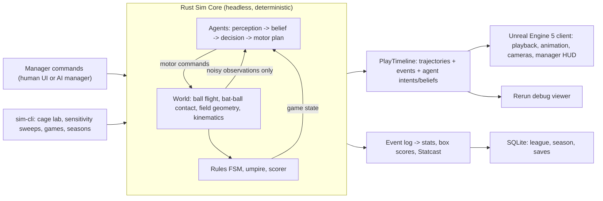

# 3D Physics-Based Baseball Management Game: Master Plan

**Last updated:** 2026-10-31
**Status:** Implementation. M0 (except the Unreal spike), M1, and M2 are done; M3 mechanisms are done with calibration open; the M4 walking skeleton plays full AI-vs-AI games in the CLI. Live status: [TASKS.md](TASKS.md).
**Sources:** [brainstorming note (2026-10-26)](./2026-10-26--physics-based-baseball-game__note.docx) · [Pass 1, Gemini](./docs/archive/PLAN-pass1-gemini.md) · [Pass 2, Claude](./docs/archive/PLAN-pass2-claude.md)

This is the single living plan. It merges Passes 1 and 2 and the owner's answers. The archived passes are kept for history only. Where they disagree with this file, this file wins.

---

## 0. Purpose

> **3D players play baseball, and every outcome comes from their physical and mental attributes, never from statistical or dice rolls.**

The human is the **manager**. They pick lineups, tactics, pitching changes, and positioning while watching the game live in 3D. Autonomous players perceive, decide, and act. Physics resolves what actually happens. Season statistics are an *output* of that process, never a target, and the league does not have to match MLB.

**Working model:** AI agents do the implementation. The owner makes the decisions. Every decision is recorded in §1 so later AI sessions don't re-argue settled questions.

---

## 1. Decision Log

| ID | Decision | Status | Rationale (short) |
| :--- | :--- | :--- | :--- |
| D1 | **No outcome rolls.** Randomness enters only as physical/physiological noise on inputs. Agents may hold probabilistic *beliefs*; the world never consults them. | **Decided** | Core purpose. §4.1 |
| D2 | Headless simulation core, fully separate from presentation | **Decided** | Fast unattended games; engine independence |
| D3 | One simulation for watched and background games; no "quick-sim" approximation | **Decided** | Background results must mean the same thing as live ones |
| D4 | Physics is authoritative; animation conforms to physical trajectories | **Decided** | Purpose |
| D5 | **Sim core language: Rust** | **Decided** (owner delegated "best") | §3 |
| D6 | **Presentation engine: Unreal Engine 5** | **Decided as target**, contingent on the M0 spike passing on current hardware (14 GiB RAM, no upgrade for now) | Highest visual and animation ceiling, so no risk of being boxed in by the engine. §3, §3.3 |
| D7 | No general rigid-body physics library in the sim core | **Decided** | Baseball physics is an ODE plus an analytic collision against static geometry. §6 |
| D8 | The sim pre-solves each pitch/play into a `PlayTimeline`; the client plays it back | **Decided** | Managers act only between pitches |
| D9 | Replays store recorded timelines, not seeds. All stats derive from the per-game event log | **Decided** | Re-simulation drifts as code changes. §4.3 |
| D10 | **Universal DH. Classic extra innings** (no automatic runner) | **Decided** (owner) | |
| D11 | Strike zone: 2D plane at the plate's midpoint depth, top and bottom scaled to batter height (ABS-style), judged exactly | **Proposed** | Simple, testable, modern. Human-umpire mode later |
| D12 | **Primary experience: managing live games.** League/season play is secondary | **Decided** (owner) | Manager layer (M6) comes before league (M7) |
| D13 | Simple geometric visuals until the final polish milestone | **Decided** (owner) | Engine must still support high fidelity later (D6) |
| D14 | A crude but rule-honest full game ("walking skeleton") at M4, before deepening each subsystem | **Adopted** | Catches integration and "fun to watch?" problems early |
| D15 | Rerun (rerun.io) as the physics/AI debug visualizer until the Unreal client exists, and as a lab tool afterward | **Proposed** | Zero engine commitment; time-scrubbable 3D logs |
| D16 | **Defensive shifts allowed** (no positioning restrictions beyond rulebook basics) | **Decided** (owner) | More managerial depth |
| D17 | **Three-batter minimum enforced** for relievers (completes three batters or the half-inning; injury exception) | **Decided** (owner) | Adds weight to bullpen timing decisions |
| D18 | **Injuries: later**, after M8, and only physically grounded (§11) | **Decided** (owner) | |

---

## 2. Architecture



**Live game loop:** the client asks the sim to advance to the next manager decision point (the next pitch). The sim solves the pitch and any resulting play in milliseconds on a worker thread and returns a `PlayTimeline`. The client animates it in real time, or skips through it under the current pacing mode. Manager commands entered during playback apply to the next pitch.

**Background games:** the same sim calls with no client attached, run in parallel by league day.

---

## 3. Technology Stack

### 3.1 Choices

| Layer | Choice | Why |
| :--- | :--- | :--- |
| Sim core | **Rust** (stable, Cargo workspace) | Engine-agnostic through a C ABI, so it links into Unreal, Godot, or Unity with no rewrite. Native speed plus `rayon` for parallel seasons. The strict compiler is valuable when AI writes most of the code, since many mistakes become compile errors instead of silent bugs. Crate boundaries can enforce D1 at compile time (§16). |
| Deterministic math | `libm` crate (pure-Rust math functions); `f64` throughout | Same transcendental results on every platform. Rust never fuses multiply-adds implicitly. Together these make cross-platform determinism *achievable* rather than just hoped for. |
| Sim ↔ client boundary | C ABI (`cbindgen` header), opaque handles, **FlatBuffers** blobs for timelines, state, and commands | Tiny API surface, zero-copy reads in C++, schema-versioned |
| Presentation | **Unreal Engine 5** (C++-first, minimal Blueprints) | Best available ceiling for realistic humans and sports presentation: Motion Matching for locomotion that follows sim-driven paths, Control Rig / full-body IK to lock hands to the physical bat and gloves to physical catch points, MetaHuman tooling for varied realistic players, cinematic cameras for broadcast framing. Linux editor available. Royalty applies only above $1M revenue. |
| Debug visualization | **Rerun** (Rust SDK) | Log pitch trajectories, swings, beliefs, and fielder routes from the CLI and scrub through them in 3D, without involving the game engine |
| Persistence | SQLite (`rusqlite`) | Single-file saves, queryable stats |
| CLI | `clap`-based `sim-cli` | Cage lab, sweeps, games, seasons |
| Testing | `cargo nextest`, `proptest` (invariants/monotonicity), `insta` (event-log snapshots), `criterion` (perf budgets) | Everything the AI builds can be checked headlessly |
| Calibration analysis | CLI writes Parquet/CSV; Python (`uv` + Polars + plotting) for notebooks and reports | Fast exploratory analysis; optional |
| Version control | Git + Git LFS (for Unreal binary assets) | Repository set up in M0 (2026-10-31); Git LFS still to install before Unreal assets |

### 3.2 Alternatives considered

| Option | Verdict |
| :--- | :--- |
| C# core + Godot 4 (Pass 1's pick) | Fast to iterate and very AI-friendly (text scenes). But Godot's rendering and animation ceiling for realistic athletes is the "subpar engine" risk the owner wants to avoid, and a C# core only fits naturally in Godot or Unity. |
| C# core + Unity 6 | Capable middle ground, but it ties the core to Unity's runtime. Unreal has the higher ceiling and Unity has no compensating advantage here. |
| C++ core | Integrates natively with Unreal, but more memory and undefined-behavior hazards and a heavier build system. Rust has the same reach via the C ABI and is safer. |
| Bevy (Rust game engine) | Elegant, but no editor and an immature high-fidelity character pipeline. |
| Jolt/PhysX/Chaos for ball and bat | Rejected (D7). Unreal's Chaos may still drive *cosmetic* effects in presentation, like a dropped bat or a flying helmet. |

### 3.3 Hardware note (owner's machine)

The machine has an AMD RX 6700S/6800S-class GPU (8 GB, Vulkan via Mesa), 16 threads, and **14 GiB usable RAM**. Plenty for the Rust sim, Rerun, and simple Unreal scenes. **Epic recommends 32 GB for UE5 development.** The owner is not upgrading RAM for now, possibly later. Fedora is not one of Epic's primary test distros.

**Why 14 GiB is probably workable until M8:** the Unreal client stays deliberately thin through M7. It has capsule players, primitive geometry, a timeline player, and HUD code; all game logic lives in Rust. The memory-hungry parts of Unreal (MetaHumans, dense environments, large animation sets) arrive only in M8. That is the natural point to revisit the RAM upgrade.

**Low-RAM working rules:**
- Use Epic's **precompiled Linux engine binaries**. Never build the engine from source, which is the most memory-hungry step.
- Cap Unreal build parallelism (`BuildConfiguration.xml`: limit parallel compile actions / memory per action) so compiles don't run out of memory.
- Keep the project minimal: no starter content, unused plugins disabled.
- Enable a generous swap/zram allowance as a safety net.
- Avoid running the Unreal editor, a C++ build, and large sim sweeps at the same time.

**M0 spike pass criteria:** editor opens and plays a capsule timeline smoothly (≥ 60 fps); an incremental rebuild of the client's C++ module completes without running out of memory in a few minutes or less; an edit → compile → play loop doesn't cause sustained heavy swapping.

**If the spike fails even with these rules,** the engine decision goes back to the owner. Options would include postponing the Unreal client until a RAM upgrade, or an interim lightweight client. The engine-agnostic Rust core keeps either option cheap.

### 3.4 Unreal usage rules (for AI-driven development)

- Game logic lives in **C++**. Blueprints only for thin visual wiring. Blueprint and animation-graph assets are binary and hard for AI to edit or review.
- Asset setup (materials, levels, animation-blueprint scaffolding) is scripted with **Unreal's editor Python API** where possible, so it is reproducible and diffable.
- Automated **screenshot and video capture** from scripted playback, so AI agents can visually check rendering changes.
- The sim runs off the game thread. Unreal never steps physics for gameplay.

---

## 4. Core Invariants

### 4.1 Beliefs versus world (enforces D1)

| Layer | May use probabilities? | Contents |
| :--- | :--- | :--- |
| **World** | **Never** to decide outcomes. Randomness only as noise on physical inputs: release angles, swing-plane error, glove-placement error, perceptual samples, bounce-surface normals. | Ball flight, contact, capture, arrival timestamps, fair/foul, strike-zone geometry |
| **Agents** (players, managers) | **Yes.** Beliefs, expected values, learned tables | "P(strike) = 0.62", "P(I beat the throw) = 0.4", run-expectancy tables |

- Agents receive only noisy **observations**. They never hold world-state types. This is enforced by the crate dependency graph (§16): `bb_agents` cannot depend on `bb_world`.
- Agents may use the *same physics equations* as internal prediction models, fed with their noisy estimates. Wrong inputs give wrong predictions, and that is how deception, misreads, and bad routes emerge.
- The official scorer's counterfactuals (hit versus error) are bookkeeping. They never change what happened.

### 4.2 Determinism

- **Guaranteed:** same build plus same seed gives the same game. Cross-platform identity is a goal, made realistic by `libm` and the no-FMA policy, and checked in CI later. Nothing depends on it, though; replays store timelines (D9).
- **Keyed counter-based RNG:** `rng(gameSeed, playIndex, agentId, purpose, subIndex)` (layout fixed in [data-formats.md §2.3](docs/data-formats.md)). Adding a random draw anywhere never shifts unrelated draws. Any single pitch can be re-run with one noise source changed.
- No hash-map iteration order in sim logic (use ordered maps or index vectors).
- Each game's seed derives from `(seasonSeed, gameId)`. League days run in parallel. Fatigue, injuries, and standings merge at day barriers.

### 4.3 Event sourcing

Every statistic (box score, leaderboard, Statcast metric) is a **pure function of the event log**. Nothing increments counters during simulation. New stats can be back-filled; accounting identities become simple tests (`PA = AB + BB + HBP + SF + SH + CI`); scorer fixes need no re-simulation.

---

## 5. Coordinates and Units

- **SI inside the sim:** m, kg, s, rad, rad/s. mph, ft, rpm only at UI and report boundaries.
- **Sim frame (right-handed, matches Statcast):** origin at the rear point of home plate at ground level; **+Y** toward the pitcher's rubber (18.44 m) and center field; **+Z** up; **+X** toward the first-base side (catcher's right).
- **Unreal frame** (left-handed, Z-up, X-forward, centimeters): `ue = 100 × (y_sim, x_sim, z_sim)`. Swapping X and Y is what changes handedness, which is correct. Rotations need the matching conversion. Both live in **one** client module; nothing else converts.

---

## 6. World Physics

> Full equations, parameters, sources, and golden tests: **[docs/physics-spec.md](docs/physics-spec.md)**. This section is a summary; the spec wins on any conflict.

### 6.1 Ball flight
- State: position **r**, velocity **v**, spin **ω**. Mass 0.145 kg, radius 0.0369 m.
- Forces: gravity; drag `−½ρA·C_D·|v|·v` with speed and spin dependence; Magnus `½ρA·C_L(S)·|v|²·(ω̂ × v̂)` with `S = Rω/v`; spin decay as a named, cited parameter.
- **Baseline parameterization:** Alan Nathan's trajectory-calculator model (C_D and C_L forms). Air density is a park/weather parameter, constant in v1.
- RK4 integration with a fixed step (2 ms pitches, 5 ms batted balls; a 10 ms step already matches 1 ms to 0.0001 ft). Events (plate, ground, walls, bat) are found on a cubic interpolant between steps, not by shrinking the step.
- Deferred: seam-shifted wake, wind.

### 6.2 Bat
- An axisymmetric profile along its axis `u` (knob → handle → taper → barrel → endcap), with mass, center-of-mass position, and moment of inertia `I_cm`.
- Pose is an **analytic function of time** from the swing model (§8.3), so the point velocity `v + Ω × r` is exact anywhere on the bat.

### 6.3 Bat-ball contact
- **Detection:** within about ±25 ms of nominal contact, sample the signed distance between the ball center and the bat surface at 0.1 ms; bisect at the first penetration to get impact time, axial position `u*`, and normal **n̂**.
- **Free-bat approximation** for the ~1 ms collision. Effective mass at distance `b` from the center of mass: `1/M_eff = 1/M + b²/I_cm`.
- **Normal impulse:** COR profile `e(u)` peaks near the sweet spot (about 0.50 for wood) and falls toward handle and endcap, with mild speed dependence. Collision efficiency `q = (e − r)/(1 + r)` with `r = m_ball/M_eff`, about 0.2 at the sweet spot.
  - Sanity anchor: exit speed ≈ q·v_pitch + (1+q)·v_bat. An 85 mph pitch at the plate and a 75 mph bat give about 107 mph.
- **Tangential impulse:** sliding/rolling friction (μ ≈ 0.5, tangential restitution) following Nathan et al.'s batted-ball spin work. Produces backspin when undercut, topspin when overcut, and sidespin from horizontal offset and bat angle.
- **Scale check:** the contact normal tilts about asin(D / (R_ball + R_bat)), roughly 0.8° per mm of offset D near center. About 2 cm of offset separates a line drive from a lazy fly ball. M2 measures the real offset→launch-angle map and uses it to set swing-noise scales.
- Foul tips and grazes emerge from large offsets. A bat-to-body contact while bunting or squaring is a hit-by-pitch rules question.

### 6.4 Field and stadium
- **Ground:** a height function (flat, plus mound cone and minor grading). Surfaces are regions (infield dirt, grass, warning track, foul territory), each with its own bounce COR, friction, rolling resistance, and roughness. Roughness sets a **small** random tilt of the bounce normal, the only source of bad hops.
- **Walls:** vertical polyline segments with height, padding COR, and a home-run rule for the top edge. **Foul poles** are cylinders. **Bases, rubber, plate** are simple solids. **Stands** are approximated by out-of-play volumes.
- Specialized analytic queries (sphere against plane, polyline, cylinder). No triangle mesh or bounding-volume tree in v1.
- **Bodies:** batters and catchers have capsule bodies for hit-by-pitch and catcher blocking. Fielders' bodies matter for blocked balls and collisions later.

---

## 7. Player Attributes: Physical and Mental

Every attribute has a **physical or cognitive meaning, a unit, and one owning mechanism**. Attributes are added only when a mechanism needs one. The UI shows them on a 20–80 scouting scale (with scouting uncertainty later).

### 7.1 Physical (body and execution)
| Role | Attribute | Meaning | Mechanism |
| :--- | :--- | :--- | :--- |
| All | `Height`, `Mass`, `Handedness` (bats L/R/S, throws L/R) | m, kg | Zone bounds, reach, swing and throw templates |
| Pitcher | `ArmSpeed` | Fastball release speed | Release velocity |
| | `SpinCapacity` | Spin rate at a given speed | Arsenal spin |
| | `Command` | Release angular σ | Location noise |
| | `Arsenal[]` | Per pitch: speed ratio, spin axis, spin efficiency, own command | Pitch definitions |
| | `Extension`, `ArmSlot`, `DeliveryTime` | m, rad, s | Release point; perceived velocity; stolen-base timing |
| | `Stamina`, `Recovery` | Pitch budget before degradation; days to recover | Fatigue |
| Batter | `BatSpeed` | Peak sweet-spot speed | Swing profile |
| | `QuickHands` | Swing duration | Commit time |
| | `BatControl` | Swing-plane σ | Execution noise |
| | `Timing` | Temporal σ | Execution noise |
| | `Adjustability` | Mid-swing correction rate | Late swing changes |
| Fielder/Runner | `Speed`, `Acceleration`, `Agility` | m/s, m/s², turn rate | Movement |
| | `Reaction` | ms after contact | Fielding perception |
| | `Hands` | Glove-placement σ | Capture |
| | `ArmStrength`, `ArmAccuracy`, `Transfer` | m/s, angular σ, s | Throws |
| Catcher | `Blocking` (pop time is derived from `Transfer` and `ArmStrength`) | Glove/body reach on balls in dirt | Wild pitches, passed balls; steals via transfer and throw |

### 7.2 Mental (perception, judgment, temperament)
| Attribute | Meaning | Mechanism |
| :--- | :--- | :--- |
| `Vision` | Precision of angular ball tracking | Batter observation noise (§8.1) |
| `SpinRecognition` | How quickly spin and seam cues reveal pitch type | Batter hypothesis posterior |
| `Discipline` | Calibration of the swing/take threshold to what the batter believes | Swing decision |
| `ReadSkill` | How fast a fielder's landing-point estimate sharpens | Fielder perception, routes |
| `JumpRead` | How early a runner detects the pitcher's commitment to home | Steal jumps, leads |
| `BaserunningIQ` | Accuracy of a runner's own arrival-versus-throw estimates; risk calibration | Advance/hold decisions |
| `FieldingIQ` | Accuracy of choosing a throw target and cutoff | Throw decisions |
| `PitchCraft` | How well a pitcher models the batter's expectations when sequencing | Pitch selection (§8.4) |
| `Composure` | How much perceptual and motor noise widen under perceived pressure | Noise scaling by leverage (§8.6) |
| `Adaptation` | How fast a batter's priors learn this pitcher's arsenal during a game | In-game learning (§8.6) |

Mental attributes act **only on beliefs and decisions**, or on noise scales, through physiological mechanisms. None of them flips an outcome directly.

---

## 8. Agents

### 8.1 Batter perception: a hypothesis bank
1. A **prior over pitch types** `π_k` comes from the pitcher's arsenal and usage by count, pitches already seen this at-bat and game, and the manager's sign. "Sitting on" a pitch deliberately sharpens the prior.
2. **For each hypothesis `k`:** from the noisy estimate of release state, predict the trajectory with type `k`'s expected spin, plus a Gaussian for within-type variation.
3. **Observations every ~10 ms:** angular ball position from the batter's eyes (σ from `Vision`); time-to-arrival from optical expansion (Weber noise); a spin cue (σ shrinks with `SpinRecognition` and viewing time).
4. **Posterior:** a Gaussian mixture over (plate x, plate z, arrival time).
5. **Commit** at about (estimated arrival − swing duration − decision latency). Swing or take uses P(strike), the expected value of contact at the aim point (§8.5), the count, and the manager directive, filtered through `Discipline`. **The aim point is the dominant mode, not the mean.** That is why tunneling works.
6. **After commit:** keep updating; adjust within limits or check the swing (§8.3).

Emergent results: tunneling, sitting on pitches, sequencing effects, the value of spin recognition, fooled check swings, and changeups playing off fastballs (perceptual anchoring through the velocity prior). Cost: tens of microseconds per pitch.

### 8.2 Pitcher execution
- The release point comes from height, arm slot, and extension.
- **Aiming inverse solve:** find release direction and speed so the *intended* pitch reaches the target, using a precomputed table plus Newton refinement.
- **Execution noise** on release angles, speed, spin rate, and spin axis. σ comes from `Command` and per-pitch command, and widens with fatigue and `Composure` under pressure.

### 8.3 Swing model: a template in a contact-relative frame
- An authored **swing template**: hand path `H(s)` and bat direction `D(s)` over phase `s ∈ [0,1]`, scaled per batter. v1 has one template per batting side; styles come later.
- **Timing profile** `s(t)` comes from `QuickHands` and `BatSpeed`.
- **Placement** `θ = (planeTilt, verticalOffset, reach, tStart)`. Horizontal location is handled mainly by timing: inside pitches are met out front, outside pitches deeper and with more reach.
- **Inverse:** aim point plus predicted arrival time → θ, via a per-template lookup table plus Newton refinement.
- **Noise:** Gaussian on θ from `BatControl` and `Timing`.
- **Adjustment:** θ moves toward the updated target at a bounded rate (`Adjustability`) until a cutoff about 50–80 ms before contact (a parameter).
- **Check swing:** brake the phase rate before `s_abort`. Whether it counts as a swing is judged geometrically.
- **Bunt:** a separate near-static template (M5).
- A biomechanical model (e.g. a double pendulum) can replace the template later behind the same interface.

### 8.4 Pitcher decisions
- Choose (pitch type, target) to maximize *believed* value: learned run-value tables (§8.5) plus a model of the batter's current priors, with an entropy term to avoid predictability. `PitchCraft` sets how accurately the pitcher models the batter's expectations.
- Manager directives (attack the zone, work the edges, pitch around, intentional walk, induce grounders) reshape the target distribution.
- Pickoffs and step-offs are decisions against runner leads (M5).

### 8.5 Learned beliefs
Agents need beliefs such as "value of a slider low and away at 1–2" or "P(out) for this throw against this runner."
1. **Bootstrap** with hand-written heuristics.
2. **Learn tables from the sim's own Monte Carlo output**, offline, and ship them as data.
3. **Iterate** until roughly stable. Regenerate per league environment (M7).

This is allowed under D1 because the tables are beliefs. It also stops AIs from exploiting each other's blind spots forever.

### 8.6 Temperament and learning
- **Composure:** each agent perceives game leverage from its own beliefs. Noise scales widen by `(1 − Composure) × leverage`. This is physiological stress on execution, not a "clutch" outcome modifier.
- **In-game adaptation:** batters' priors and trajectory models for a pitcher improve with exposure, at a rate set by `Adaptation`. The **times-through-the-order penalty emerges** from this rather than being scripted. Pitch fatigue compounds it.

### 8.7 Fielders, runners, and coordination
- **Fielder perception:** after `Reaction`, a noisy estimate of the landing or intercept point that sharpens at a rate set by `ReadSkill`. Bad first steps and imperfect routes emerge from it.
- **Movement:** acceleration- and turn-limited kinematics toward the current estimate, re-planned at 20–50 Hz.
- **Capture:** the glove moves to the predicted catch point under a hand-speed limit. At the catch instant the glove pose has Gaussian error (σ from `Hands`, inflated by ball speed, late reads, reaching, short hops). Outcome is purely geometric: pocket gives a catch; rim gives a damped physical deflection; outside gives a miss. Validation: routine plays must succeed well above 98%.
- **First base:** foot-on-bag reach volume, a stretch that trades time for distance, scoops as short-hop captures with higher σ, and a decision to come off the bag when the throw is out of reach.
- **Throws:** ballistic solve to the receiver's target, with noise from `ArmAccuracy` inflated by rushed transfers. The receiver runs the same capture test.
- **Coordination:** a defensive coordinator assigns primary fielder, backups, coverage, and cutoffs from **beliefs**. Mix-ups can emerge.
- **Runners:** leads and secondary leads; jumps read from the pitcher's move (`JumpRead`); advance or hold from their own noisy arrival-versus-throw estimates (`BaserunningIQ`); tag-up and halfway decisions; base-coach sends under the manager's aggressiveness setting.

---

## 9. Rules, Umpire, Scorer

**League rules:** universal DH; classic extra innings (D10); defensive shifts allowed (D16); three-batter minimum for relievers (D17).

Three-batter-minimum details: a reliever must face three batters or finish the half-inning before being removed, except for injury (once injuries exist). It is enforced by the rules engine's substitution legality check, arrives with substitutions in M6, and is respected by the AI manager's bullpen planning.

**v1 scope (M4):** balls and strikes (D11 zone); fouls including two-strike fouls and foul tips; walks; strikeouts; uncaught third strike; hit by pitch (body capsules plus a simple evasion reaction); fair/foul; force and tag outs; caught flies with tag-up; runs including time plays on third outs; inning and game flow; extra innings; ground-rule doubles; home runs; substitution legality including the DH.

**M5 additions:** infield fly, balks (if pickoff moves exist), catcher's interference, obstruction basics.

**Deferred:** appeals, batting out of order, manager challenges, pitch clock. Pacing is a presentation concern; the sim has no clock between pitches.

**Testing:** a **scenario corpus** of data files, each a scripted event sequence plus the expected resulting state. The rules state machine is tested with no physics involved.

**Official scorer:** hits versus errors versus fielder's choice via counterfactual thresholds (e.g. would an ordinary clean play have retired the runner?), plus full Statcast-style telemetry: exit velocity, launch angle, spray, spin, induced vertical/horizontal break, contact offset, hang time, sprint speed, throw speed, route efficiency.

---

## 10. Manager Layer (primary experience, D12)

### 10.1 Levers
Every lever adjusts **agent decision policies**, never physics.
- **Pre-game:** lineup, defensive alignment, starting pitcher, bench and bullpen roles.
- **Pitching:** normal, attack the zone, work the edges, pitch around, intentional walk, induce grounders, pickoff/step-off, mound visit.
- **Batting:** normal, take, patient, ambush (sit on a pitch), protect, elevate, sacrifice bunt, hit-and-run, safety and suicide squeeze.
- **Defense:** infield (normal, corners in, all in, double-play depth, guard lines, full shifts); outfield (shallow, normal, deep, no-doubles, shade left/right).
- **Running:** straight steal, delayed steal, base-coach aggressiveness.
- **Bullpen:** **physical warm-up**. Relievers need simulated time and pitches to go from cold to ready, and overwarming tires them. Plus pinch hitters, pinch runners, double switches.

### 10.2 Live pacing modes
Watch every pitch ↔ watch balls in play and high-leverage pitches only ↔ sim to end of half-inning, to a chosen inning, or to the end of the game. All modes run the same simulation.

### 10.3 Causal play explanations (core feature)
Timelines record agent belief snapshots, so the game can explain **why** a play happened:

> "Read fastball (78% at commit). The slider broke 11 cm under his swing plane; topped to short, 71 mph."

> "The center fielder's first step was in. The initial depth read was 9 m short, cost about 0.4 s, and the ball landed 1.2 m past his reach."

This makes the physical depth visible, and shows the manager whether tactics worked.

### 10.4 AI manager
Uses the identical command API. Driven by win- and run-expectancy beliefs (§8.5), matchup and archetype reasoning, observed fatigue, and personality profiles (analytics-driven, small-ball, quick hook).

---

## 11. League and Season (secondary)

A procedural world generator (league, divisions, schedule, **parametric ballparks** with dimensions, wall heights, foul territory, altitude, and surface speed, giving emergent park factors, and correlated player populations); multi-day fatigue and recovery; SQLite saves; standings, leaderboards, player cards; a parallel day-slate simulator; regenerated learned-belief tables per league. **Injuries (D18, after M8)** must be physically grounded, never a random injury roll. Sketch: each player has a hidden physical *tissue tolerance* set at generation. The sim accumulates physical load (pitch counts and high-effort pitches, sprint and collision loads, hit-by-pitch impact energy). An injury occurs when load crosses that tolerance. The uncertainty lives in the hidden attribute, the same way the rest of the game keeps randomness in noise on inputs. Fatigue tracking from M6 should therefore record cumulative physical load in a form this model can use later.

---

## 12. Presentation (Unreal Engine 5)

- **Timeline player:** interpolates sim trajectories (ball, bat pose, player roots) at render rate. Fully decoupled from sim timing.
- **Through M7: geometric visuals** (D13). Capsule players, a primitive bat and glove, ball trails, a strike-zone overlay, a field with lines, a scoreboard.
- **M8 characters:** the sim drives root motion. **Motion Matching** picks locomotion poses that fit sim velocities. Authored pitching, swinging, and throwing clips are **time-warped to sim timings** (release, contact, catch). **IK** locks hands to the physical bat and gloves to physical catch points. Animation sources: Epic's free Game Animation Sample for locomotion; baseball-specific motions purchased or captured later.
- **Cameras:** broadcast center-field and behind-plate views, a tracking camera on balls in play, a replay director.
- **Overlays:** Statcast panel, pitch tunnels, spin axes, swing path, fielder routes, explanation cards (§10.3).
- **Manager HUD/UI:** CommonUI/UMG built in C++ for AI editability. Final UI approach decided at M6.
- **Audio (M8):** bat crack driven by exit speed and sweet-spot offset; crowd reacting to leverage.

---

## 13. Calibration and Verification

### 13.1 Two separate targets
| Tier | Must match reality? | Examples | Method |
| :--- | :--- | :--- | :--- |
| **A. Physics validation** | **Yes** | Pitch break versus spin; carry (100 mph / 30° / 2500 rpm reaching 406 ft in 5.6 s, Nathan's reference case); q ≈ 0.2 at the sweet spot; spin versus undercut | Golden tests against Nathan's trajectory calculator and published collision results. **Tested, never tuned toward stats.** |
| **B. Playability envelope** | **No.** Distinct league allowed; must still be watchable baseball | Runs/game, K%, BB%, batting average on balls in play, HR/game, steals, errors, pitches per game | Tuned **only** through ability distributions and noise scales |

### 13.2 Method
- A small set of **global knobs**: perceptual noise scale, command scale, swing-plane scale, fielder reaction scale, bat-speed distribution.
- `sim-cli sensitivity` sweeps knobs and individual attributes, asserts **monotonicity** (e.g. more `BatSpeed` never lowers mean exit velocity), and records elasticities.
- If no knob setting reaches the envelope, **a model is wrong**. Fix the model; never add a fudge factor.

### 13.3 CLI lab
- `sim-cli cage --pitches 50000 [--batter X --pitcher Y]`: plate-discipline and contact distributions.
- `sim-cli sensitivity`: sweeps plus monotonicity assertions.
- `sim-cli game --seed N [--rerun]`: one game, optionally streamed to Rerun.
- `sim-cli season --teams 12 --games 162 --threads 16`: league environment, park factors, accounting checks.

### 13.4 Performance budget
**≤ 200 ms per headless game on one core.** Measured from M3 and tracked with `criterion`. At that cost a 12-team, 162-game season (972 games) runs in under 15 s on 16 threads. Agent cognition, not ball physics, is the expected hot spot.

---

## 14. Roadmap

| Milestone | Scope | Exit gate |
| :--- | :--- | :--- |
| **M0: Foundations** | Git + LFS; Cargo workspace (§16); vector math, units, keyed RNG; event-log and timeline FlatBuffers schemas; Rerun hello-world; `CLAUDE.md` with invariants and conventions. **Unreal spike:** install UE5 on this Fedora machine, link the Rust library through the C ABI, play a hand-built timeline with capsules; record RAM use and compile times. | Deterministic event-log hash across runs; **spike meets §3.3 pass criteria → D6 confirmed** (otherwise the engine decision returns to the owner) |
| **M1: Pitch flight** | RK4 flight; pitch definitions; aiming solve plus release noise; Rerun pitch viewer (trails, zone, tunnels) | Tier A pitch golden tests pass; fastball and slider visibly share early flight |
| **M2: Bat and contact** | Swing template plus inverse; swept contact; impulse model; batted-ball flight over a flat field; Rerun cage view | Tier A collision tests; scripted sweeps show early→pull, late→opposite field, undercut→backspin fly, overcut→topspin grounder, off-barrel→weak; offset→launch-angle map recorded |
| **M3: Batter vs pitcher** | §7 attributes needed so far; hypothesis-bank perception; swing/take; check swing; heuristic pitcher AI; composure and adaptation; `cage` and `sensitivity`; perf measured | Archetypes produce distinct profiles; monotonicity suite passes; plate-appearance rates in rough Tier B bands; within budget |
| **M4: Walking skeleton + Unreal client v0** | Flat field, fences, foul lines; simple fielders (reaction, noisy estimate, run, capture); ballistic throws; simple runners; v1 rules (§9); event-sourced box score; AI-vs-AI spectator mode in Unreal with capsules, a basic broadcast camera, a scoreboard | A full game plays end to end in the CLI and in Unreal; accounting holds over 1,000 games; **owner judges watchability** |
| **M5: Deepen the field** | Surfaces, bounces, rolls, wall caroms, mound; full fielding including first base; relays and cutoffs; catcher blocking; leads, steals, tag-ups, rounding, slides; bunts; pickoffs; M5 rules | 10,000 balls in play, no stuck states; routine-play success above threshold; error and extra-base rates in envelope |
| **M6: Live management** (primary experience) | Command API; human manager HUD; AI manager; pacing modes; fatigue; bullpen warm-ups; substitutions; causal explanations; first learned-belief tables | Human-vs-AI game is fun to manage; A/B sims show each tactic changes outcomes in the expected direction |
| **M7: League** | Generator, schedules, parametric parks, recovery, saves, standings, leaderboards, parallel seasons, per-league belief tables | Full season playable; managed live games interleave with instant background days |
| **M8: Presentation** | Characters, Motion Matching, IK, broadcast camera director, replays, audio | Owner's quality bar |

**Deferred past M8:** seam-shifted wake, weather and wind, human-umpire mode and framing, swing styles, evolving mechanics, scouting inferred from behavior, injuries, online human-vs-human play (authoritative host streaming timelines).

---

## 15. Repository Layout

```text
3D Baseball/
├── PLAN.md                         # this file
├── CLAUDE.md                       # invariants + conventions for AI agents (M0)
├── docs/
│   ├── physics-spec.md             # equations, parameters + citations, golden cases
│   ├── agent-models.md             # perception, swing, decisions, learned beliefs
│   ├── data-formats.md             # event log, PlayTimeline, commands (FlatBuffers)
│   ├── calibration-targets.md      # Tier A values, Tier B envelopes
│   ├── rules-spec.md               # rules FSM, umpire, scorer, scenario corpus
│   └── archive/                    # earlier plan passes
├── sim/                            # Cargo workspace
│   ├── schemas/                    # *.fbs
│   └── crates/
│       ├── bb_math/                # vectors, units, keyed RNG, libm wrappers
│       ├── bb_physics/             # PURE models: flight, bat profile, collision, surfaces
│       ├── bb_observe/             # observation types (the only window agents get)
│       ├── bb_world/               # true world state + resolution (uses bb_physics)
│       ├── bb_agents/              # players + managers (bb_physics, bb_observe; NOT bb_world)
│       ├── bb_rules/               # rules FSM, umpire, scorer
│       ├── bb_game/                # orchestrator: world <-> agents <-> rules, timeline recorder
│       ├── bb_stats/               # event log -> box scores, Statcast, leaderboards
│       ├── bb_league/              # generator, schedule, season runner, SQLite
│       ├── bb_ffi/                 # C ABI for the engine client
│       └── bb_cli/                 # sim-cli (+ Rerun logging)
├── analysis/                       # Python notebooks for calibration (optional)
└── client/                         # Unreal project
    └── Plugins/BaseballSim/        # links bb_ffi; timeline player; coordinate conversion
```

The `bb_agents` ↛ `bb_world` dependency rule makes D1's belief/world split a **compile-time guarantee**.

---

## 16. AI-Driven Development Workflow

- **Every change must be checkable headlessly:** unit, golden, property, and snapshot tests; CLI distribution reports; scripted Unreal screenshots for visual checks.
- **`CLAUDE.md`** holds the invariants (D1–D4, §4), units and frames, the Unreal usage rules (§3.4), and testing expectations. Every AI session loads it.
- **[TASKS.md](TASKS.md) is the live to-do list.** Update it at the end of every work session.
- **This decision log is binding.** Reopening a decided item requires the owner.
- **Specs before code** for the risky subsystems (§19). Implementation then follows the spec, and tests come from the spec's golden cases.
- **Small milestones with explicit exit gates.** The owner reviews at gates, not line by line.

---

## 17. Risks

| Risk | Likelihood | Impact | Mitigation |
| :--- | :--- | :--- | :--- |
| Emergent stats land outside the playability envelope | High | High | Tier A first; sensitivity elasticities; unreachable envelope means a model bug (§13.2) |
| Manager choices feel weak or opaque | Medium | **High** (primary experience) | A/B tactic gates at M6; causal explanations (§10.3) |
| Unreal too heavy on 14 GiB RAM or problems on Fedora | Medium | Medium | Thin client through M7; low-RAM working rules and M0 spike (§3.3); revisit RAM before M8; engine-agnostic core keeps a switch cheap |
| AI agents struggle with Unreal's binary assets | Medium | Medium | C++-first; editor Python scripting; minimal Blueprints (§3.4) |
| AI-vs-AI degenerate strategies | Medium | Medium | Sequence-aware priors; iterated learned tables (§8.5) |
| Statistical fallbacks creep in | Medium | High | Compile-time crate split; review rule "every outcome traces to geometry or a timestamp" |
| Scope | High | High | Walking skeleton at M4; attributes added only on demand; rules scope list |
| Replays drift as code changes | High if done naively | Medium | Store timelines (D9) |

---

## 18. Open Questions

None blocking. Pending items:
- D6 is confirmed or reopened by the M0 spike (§3.3).
- RAM upgrade: revisit before M8 (characters and visual polish).

## 19. Next Planning Artifacts

The live, checkbox-level task list is **[TASKS.md](TASKS.md)**. This section only names the documents.

1. `docs/physics-spec.md`: gates M1–M2. **Draft v1 written 2026-10-30**; its open items are in its §17.
2. `docs/data-formats.md`: gates M0. **Draft v1 written 2026-10-31**; its open items are in its §10.
3. `docs/agent-models.md`: gates M3. **Draft v1 written 2026-10-31**; its open items are in its §13.
4. `docs/calibration-targets.md`: gates M3–M5. **Draft v1 written 2026-10-31**; its open items are in its §13.
5. `docs/rules-spec.md`: gates M4. **Draft v1 written 2026-10-31**; its open items are in its §15.
6. `CLAUDE.md`: written in M0, from §1, §4, §5, §3.4, §16.
