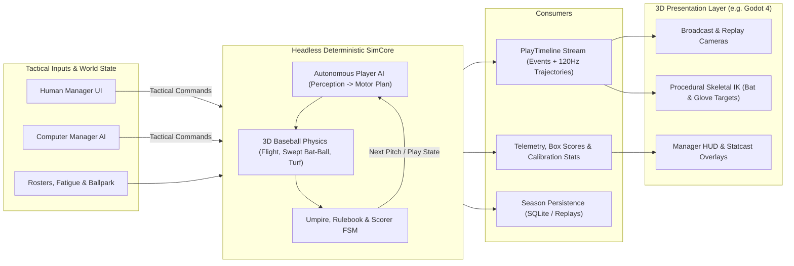
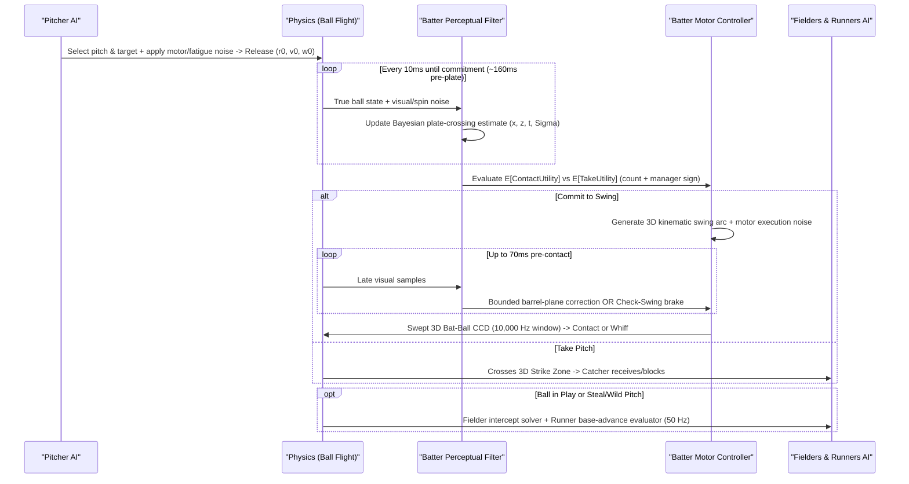
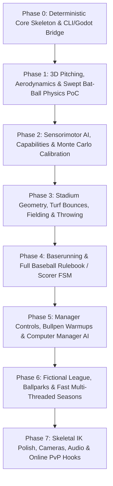

# 3D Physics-Based Baseball Management Game — Technical Architecture & Implementation Plan (Pass 1)

Grounded in [2026-10-26--physics-based-baseball-game__note.docx](./2026-10-26--physics-based-baseball-game__note.docx), this document establishes the first-pass engineering blueprint for a 3D baseball management simulation where **all plays, box scores, and season statistics emerge strictly from physical interactions, player capabilities, and autonomous sensorimotor decisions—never from predetermined hit/out probability rolls.**

---

## 1. Architectural Thesis & Non-Negotiable Invariants

To keep development tractable while honoring the simulation's core philosophy, the entire codebase should enforce four architectural invariants from day one:

1. **Zero Outcome Rolls (`No-Cheat Invariant`)**: No function in the codebase may roll for "hit vs. out," "strikeout probability," or "fielding percentage." Randomness may enter **only** as physical/physiological noise: perceptual measurement error, motor execution variance, fatigue drift, and micro-surface bounce perturbations.
2. **Strict Headless Simulation Core (`SimCore` $\perp$ `Presentation`)**: The simulation engine must compile and run as a standalone library/CLI with **zero dependency** on rendering, animation, audio, or game-engine scene trees.
3. **Single Unified Engine for Live & Unattended Games**: Background league games and watched 3D games must execute the **exact same 3D physical simulation** via event-driven phase stepping—never a separate "statistical quick-sim" approximation that diverges from live play.
4. **Physics-Authoritative Presentation**: The physical simulation determines ball, bat, and player trajectories first; 3D skeletal animations and inverse kinematics (IK) conform to those physical trajectories, never the reverse.



---

## 2. Resolving the Four Open Questions (Engineering Recommendations)

### Q1: Should whole seasons run rapidly without rendering, or primarily be watched live?
**Recommendation: Support both seamlessly with ONE physics engine using Event-Driven Phase Stepping.**

A common misconception is that 3D physics is too slow to simulate thousands of background games. In baseball, high-frequency physics is only needed during **active ball phases**, while inter-pitch dead time (walking back to the mound, stepping into the box) requires zero physics ticks:

| Active Phase per 9-Inning Game | Count / Game | Sim Duration | Physics Rate | Steps / Game | Estimated Single-Core CPU Cost |
| :--- | :---: | :---: | :---: | :---: | :---: |
| **Pitch Flight & Swing Window** | ~300 pitches | ~0.5 s | $1000\text{ Hz}$ ($0.1\text{ ms}$ near plate) | ~160,000 | ~4–6 ms |
| **Batter Perceptual Updates** | ~300 pitches | ~0.45 s | $100\text{ Hz}$ | ~1,500 | < 1 ms |
| **Ball-in-Play Flight / Bounce / Roll** | ~50 fair/foul plays | ~5.0 s | $500\text{ Hz}$ | ~125,000 | ~4–6 ms |
| **Fielder & Runner Kinematics / Intercepts** | ~50 plays $\times$ 13 agents | ~5.0 s | $50\text{ Hz}$ | ~160,000 | ~8–15 ms |
| **Rulebook, AI Manager & Stats** | ~300 events | Discrete | Event-driven | ~300 | < 2 ms |
| **Total per Full 9-Inning Game** | — | — | — | **~450,000 lightweight ops** | **~18–30 ms / game (1 core)** |

> [!TIP]
> At **~20–30 ms per full game on a single core** (allocation-free structs/SIMD), an 8-core CPU simulates **250–400 complete 3D physics games per second**—meaning an entire 162-game, 30-team season ($2,430$ games) finishes in **6–10 seconds** (and a 12-team fictional league season in **< 2 seconds**) with zero statistical shortcuts.

---

### Q2: How much physics detail is necessary for the first prototype?
**Recommendation: High fidelity on aerodynamics and oblique bat-ball contact; simplified kinematics everywhere else.**

In baseball, millimeter-level bat-ball geometry is *everything* (a $6\text{ mm}$ vertical offset separates a grounder, a $28^\circ$ home run, and a pop-up), whereas modeling full rigid-body human joints is unnecessary overhead.

* **Essential for Prototype v1 (Phases 1–2)**:
  * **3D Pitch & Batted-Ball Aerodynamics**: Gravity + speed/spin-dependent Drag + 3D Magnus Force + spin rate decay, integrated via 4th-order Runge-Kutta (RK4) at $\Delta t = 1\text{ ms}$.
  * **6-DOF Kinematic Bat Trajectory**: Parameterized 3D swing arc (hand path + barrel angular whip + attack angle + plane tilt) advancing continuously through 3D space.
  * **Continuous Swept Bat-Ball Collision**: Sub-stepped ($0.1\text{ ms}$ near home plate) analytical sphere-vs-lathe/capsule-frustum continuous collision detection (CCD) capturing **both linear translation and high-speed angular barrel rotation**.
  * **3D Oblique Bat-Ball Impulse Model**: Based on Alan Nathan's canonical baseball collision physics—axial apparent bat mass & sweet-spot coefficient of restitution $e_A(u)$ (energy loss toward handle/endcap) coupled with tangential friction/rolling impulse to naturally produce exit velocity, launch/spray angle, and 3D post-contact spin (backspin, topspin, hook/slice).
* **Defer Past Prototype v1**:
  * Turf/dirt bounce & roll, stadium wall segments, and kinematic fielders/runners (**Phases 3–4**).
  * Seam-shifted wake (SSW) aerodynamics, wind/altitude/temperature air density modifiers, bat vibration/broken bats, and catcher framing physics (**Phase 7+**).

---

### Q3: Which engine, language, and physics library offer the best long-term balance?
**Recommendation: Pure `.NET 8/9` (`C#`) Headless `SimCore` + Godot 4 (.NET Edition) for 3D Presentation + Custom Domain Physics (NO general-purpose rigid-body engine for ball/bat).**

> [!IMPORTANT]
> **Why you should NOT use Jolt/PhysX/Rapier for pitch flight or bat-ball collision:**
> A $95\text{ mph}$ pitch meeting a $75\text{ mph}$ barrel closes at **$170\text{ mph}$ ($76\text{ m/s}$)** while the bat rotates at $>35\text{ rad/s}$. Most rigid-body engines' CCD sweeps *linear* translation well, but approximates *angular* sweeps coarsely, uses scalar restitution (missing axial sweet-spot vibration loss), and treats friction simply (failing to produce accurate backspin/sidespin gear-effect coupling). Writing a **custom ~400-line analytical swept bat-ball solver + RK4 aerodynamic integrator** is simpler, 10–50x faster, cross-platform deterministic, and physically far more faithful to baseball than fighting a general rigid-body solver.

For stadium walls and ground meshes in Phase 3, you only need a **lightweight static BVH / triangle-mesh & analytical plane/cylinder query module** (trivial in pure C# or Rust), keeping `SimCore` 100% free of native C++ physics FFI headaches.

| Option | Language & `SimCore` | 3D Engine | Pros | Cons / Risks | Verdict |
| :--- | :--- | :--- | :--- | :--- | :--- |
| **Option A (Recommended)** | **C# 12+ (`.NET 9` standalone library)** | **Godot 4 (.NET)** | Zero-FFI in-process integration; fast iteration on complex rulebook/AI/UI; strong SIMD (`System.Numerics`); open-source lightweight editor; instant CLI test runner (`dotnet test`). | Must avoid GC allocations in inner physics loop (`readonly record struct`, `Span<T>`); Godot 3D IK ecosystem is leaner than Unity's (requires custom Two-Bone IK setup). | **Best overall balance** |
| **Option B** | **Rust (`SimCore` crate)** | **Godot 4 (`gdext`)** | Peak raw CPU speed; `rayon` parallelism; strict compile-time memory layout & determinism. | `gdext` FFI boilerplate slows iteration on rich UI/debug data structures between sim and editor. | **Strong runner-up** (if team prefers Rust) |
| **Option C** | **C# (`.NET Standard` library)** | **Unity 6** | Mature animation rigging/IK & camera tools (Cinemachine). | Heavier editor/runtime footprint, licensing friction, slower headless CI workflow than pure `.NET` + Godot. | Viable alternative presentation host |

*(Note: Because `SimCore` is isolated, moving presentation between Godot 4 and Unity later—or running a web dashboard over CLI outputs—never touches simulation code.)*

---

### Q4: How should autonomous batter/pitcher decision-making and execution be calibrated?
**Recommendation: Model a biologically grounded Perception–Prediction–Motor (PPM) loop, calibrated via an automated Monte Carlo CLI harness using monotonicity & plausibility invariants.**

Why pure geometry + naive noise fails:
* If a batter knows exact ball coordinates and you add $\pm 5\text{ cm}$ random swing noise, fastballs and curveballs get hit at the exact same rate—**pitch tunneling and deception disappear!**
* Instead, deception must emerge from **time-constrained noisy state estimation**:
  1. The batter's swing takes $T_{\text{swing}} \approx 145\text{–}185\text{ ms}$ (governed by `BatSpeed` and `QuickHands`).
  2. Therefore, the batter **must commit** to launching a swing when the ball is still $\sim 160\text{ ms}$ away from home plate!
  3. Up to that commitment point, the batter only receives noisy visual samples of ball position, velocity, and spin cues (filtered through `Vision` and `SpinRecognition` attributes via a lightweight Bayesian/Kalman trajectory predictor).
  4. A late-breaking slider that tunnels along a fastball trajectory for the first $250\text{ ms}$ causes the batter's internal forward model to predict the *fastball* arrival point at $t_{\text{commit}}$, naturally inducing whiffs, check-swings, or weak end-of-bat/handle contact—with **Bounded Mid-Swing Adjustment** (`Adjustability`) allowing skilled contact hitters to partially bend their barrel plane late!

---

## 3. Complete System Inventory: What Is Needed to Implement This Game

Implementing the complete game requires **nine modular subsystems**:

### 3.1 Coordinate System, Units, & Determinism Foundation
* **Internal Units**: Strict SI (`meters`, `kilograms`, `seconds`, `radians`, `rad/s`) everywhere inside `SimCore`; convert to `mph`, `feet`, `inches`, `rpm` solely at UI/report boundaries.
* **Canonical Right-Handed Coordinate Frame**:
  * Origin `(0, 0, 0)` at the rear apex of home plate at ground level.
  * `+Y` axis pointing straight through the pitcher's rubber ($y = 18.44\text{ m}$) toward center field.
  * `+Z` axis pointing vertically upward against gravity.
  * `+X` axis pointing toward the 1st-base side (catcher's right / RHB opposite field).
* **Deterministic Seeded PRNG Streams**: Explicit `RngStream` instances partitioned by domain (`PitcherMotorRng`, `BatterPerceptionRng`, `FieldingSurfaceRng`, `UmpireRng`, `ManagerAiRng`) using a fast counter/xoshiro256** generator (`double` precision math in `SimCore` for cross-platform stability).
* **Network-Friendly Determinism Note**: For future online human-vs-human management, managers only issue tactical decisions *between* pitches/plays. An authoritative host can simulate each pitch in $<0.2\text{ ms}$ and stream a compact `2–5 KB` `PlayRecording` packet to both clients—completely avoiding fragile cross-CPU floating-point lockstep bugs!

### 3.2 Aerodynamics & Ball–Bat–Environment Physics Engine
* **Baseball Rigid State**: Position $\mathbf{r} \in \mathbb{R}^3$, velocity $\mathbf{v} \in \mathbb{R}^3$, spin vector $\boldsymbol{\omega} \in \mathbb{R}^3$, radius $R = 0.0366\text{ m}$, mass $m = 0.145\text{ kg}$.
* **Aerodynamic Forces**:
  * Gravity: $\mathbf{F}_g = (0, 0, -mg)$.
  * Drag: $\mathbf{F}_D = -\frac{1}{2}\rho A C_D(v, S) v \mathbf{v}$, where $C_D$ captures Reynolds-number & spin-induced drag variation.
  * Magnus Lift: $\mathbf{F}_M = \frac{1}{2}\rho A C_L(S) v^2 (\hat{\boldsymbol{\omega}} \times \hat{\mathbf{v}})$, with spin factor $S = R\|\boldsymbol{\omega}\| / v$ and empirically tuned $C_L(S)$ curve.
  * Spin Decay: Exponential aerodynamic torque damping $\|\boldsymbol{\omega}\|$ over long outfield flights (~15–25% decay over 5 seconds).
* **Parametric Bat Model & Swept CCD**:
  * Bat represented as an axisymmetric profile along local axis $u \in [0, L]$ (knob $\to$ handle $\to$ taper $\to$ barrel radius $R_{\text{bat}}(u) \le 0.033\text{ m}$ $\to$ rounded endcap), with mass $M_{\text{bat}}$, center of mass $u_{\text{cm}}$, and moment of inertia $I_{\text{cm}}$.
  * Bat pose over time $\mathbf{T}_{\text{bat}}(t) = (\mathbf{p}_{\text{knob}}(t), \mathbf{q}_{\text{bat}}(t))$ with analytical linear velocity $\mathbf{v}_{\text{bat}}(u, t)$ and angular velocity $\boldsymbol{\Omega}_{\text{bat}}(t)$.
  * When $\|\mathbf{r}_{\text{ball}} - \mathbf{p}_{\text{plate}}\| < 1.5\text{ m}$, step at $\Delta t = 0.1\text{ ms}$ (with root-finding bisection on interval $[t, t+\Delta t]$ upon penetration) to determine exact time of impact $t^*$, axial station $u^*$, and 3D contact normal $\hat{\mathbf{n}}$ (pointing from bat centerline through ball center).
* **3D Oblique Bat-Ball Collision Solver**:
  * Decompose relative velocity at the contact patch (accounting for both ball surface spin velocity $\boldsymbol{\omega} \times (-R\hat{\mathbf{n}})$ and bat local velocity) into normal component $v_n$ and 2D tangential plane vector $\mathbf{v}_t$.
  * Compute axial effective restitution $e_A(u^*)$ peaking around the sweet spot ($u^* \approx 0.68\text{–}0.73\text{ m}$ from knob, $e_{\max} \approx 0.50\text{–}0.52$) and rolling off quadratically toward the handle and endcap to model vibrational energy loss.
  * Solve coupled normal impulse $J_n$ and tangential impulse $\mathbf{J}_t$ (clamped by dynamic Coulomb friction $\mu J_n$ vs. rolling/grip limit $e_t$), outputting post-collision ball velocity $\mathbf{v}'$, post-collision ball spin $\boldsymbol{\omega}'$, and recoil dampening on bat follow-through.
* **Stadium & Surface Bounce/Roll Physics**:
  * Parametric stadium definition: infield dirt polygon, outfield grass, pitcher's mound cone/slope, foul lines, warning track, segmented wall polyline (each segment having height, wall normal, padding COR, and home-run/in-play top rule), backstop/dugout out-of-play boundaries.
  * Oblique turf bounce solver: surface-specific normal COR ($e_z \approx 0.35$ lush grass, $0.52$ hard dirt, $0.45$ wall pad), horizontal friction/spin coupling, surface micro-normal perturbation $\delta\hat{\mathbf{n}}$ (scaled by dirt roughness vs. manicured grass to produce emergent bad hops), and rolling deceleration.

### 3.3 Player Capability Schema (Physical & Cognitive Ratings)
Players are defined strictly by continuous physical/cognitive traits (internally stored in physical units or normalized $z$-scores mapped via biomechanical transfer curves; optionally displayed to users on a scouting `20–80` scale with scouting uncertainty):

* **Anthropometrics & Conditioning**: Height (directly sets physical strike zone top/bottom & 1B/outfield reach radius), mass, handedness (bats L/R/S, throws L/R), acute pitch/sprint stamina, multi-day recovery rate.
* **Pitching Traits**:
  * Delivery kinematics: Arm slot angle (overhand $\to$ sidearm/submarine), release extension ($1.6\text{–}2.2\text{ m}$), delivery time to home (slide-step vs. full windup, directly driving stolen-base physics!).
  * Neuromuscular output: Peak arm speed (drives fastball $v_0$), raw spin capacity, release-point & angular command repeatability ($\Sigma_{\text{release}}$).
  * Pitch Arsenal (2–6 pitches): Each pitch specifies grip velocity ratio, spin efficiency ($0\text{–}100\%$ active transverse spin vs. gyro spin), spin-axis tilt offset, and individual pitch command mastery.
* **Batting Traits**:
  * Biomechanics: Peak barrel speed ($28\text{–}38\text{ m/s}$), rotational acceleration / quick hands (determines swing duration $T_{\text{swing}}$), natural attack-angle preference & plane adaptability, check-swing braking torque.
  * Sensorimotor & Cognition: Visual tracking precision, spin/seam recognition speed, spatial barrel coordination ($\sigma_{\text{plane}}$), temporal rhythm/timing precision ($\sigma_t$), tactical discipline / impulse control.
* **Fielding & Baserunning Traits**:
  * Locomotion: Peak sprint speed ($7.0\text{–}9.5\text{ m/s}$), first-step acceleration, turn/deceleration agility.
  * Fielding: Reaction delay ($150\text{–}300\text{ ms}$), aerial trajectory read accuracy, glove capture aperture & soft-hands dampening (resisting high-speed/bad-hop deflections), transfer time ($0.5\text{–}1.1\text{ s}$), throwing arm speed & angular throw accuracy, catcher blocking & pitch-framing subtlety.

### 3.4 Autonomous Player AI (Perception–Prediction–Motor Loop)



* **Pitcher Decision AI**: Evaluates pitch-location candidates on a 2D grid across/outside the strike zone by estimating expected run value given count, batter's observed/scouted swing tendencies, pitch sequence entropy (avoiding predictability), current pitch command ellipse (widened by fatigue!), and manager directive.
* **Batter Decision & Swing AI**:
  * Maintains a real-time trajectory belief state; early in flight, spin-break uncertainty shrinks faster for high-`SpinRecognition` batters.
  * Computes expected value of swinging vs. taking (factoring in count leverage: protective wide threshold at 2 strikes, selective barrel-hunting threshold at 2-0 / 3-1).
  * Parameterizes a 6-DOF kinematic swing curve targeting predicted $(\hat{x}, \hat{y}_{\text{hit}}, \hat{z}, \hat{t})$, where $\hat{y}_{\text{hit}}$ adjusts naturally for inside pitches (met further out front) vs. outside pitches (let travel deeper).
* **Fielder & Baserunner AI**:
  * **Fielders**: Upon contact (plus individual reaction latency + initial read error on launch direction/depth), each fielder computes earliest intercept time along the predicted ball flight/bounce trajectory. A lightweight **Defensive Coordinator** assigns primary ball-hawk, backup outfielder, base coverers, and cutoff/relay alignment dynamically.
  * **Physical Catch & Deflection Model (No RNG Error Rolls!)**: Each fielder's glove tracks toward the predicted ball position subject to hand-speed limits and bad-hop reaction limits. Capture succeeds if the ball enters the physical glove aperture within closing-speed and hand-alignment tolerances; borderline contacts physically deflect off the glove rim/body at reduced speed, creating **emergent bobbles, ricochets, infield singles, and throwing-rush errors**.
  * **Throwing & Baserunning**: Fielders predict runner arrival times at candidate bases against their own transfer + ballistic throw flight time, choosing the highest expected-out / run-prevention throw (or holding the ball). Runners evaluate lead distance, steal jumps (reading pitcher delivery onset), fly-ball catch likelihood (tag-up vs. halfway), and rounding/sliding physics.

### 3.5 Baseball Rulebook, Umpire, & Official Scorer Engine
Baseball has subtle edge cases; isolating rules into a deterministic, heavily unit-tested **Finite State Machine (FSM)** prevents physics code from becoming tangled with legal logic:
* **3D Strike Zone & Umpire**: True 3D pentagonal prism over home plate bounded vertically by each batter's physical stance knees and midpoint-of-torso. Supports **Exact ABS Mode** (any graze of ball sphere against prism) and **Human Umpire Mode** (perceptual boundary uncertainty + subtle influence from catcher receiving pocket stability).
* **Fair / Foul & Dead-Ball Logic**: Exact 3D rules—ball settling or touched before 1B/3B planes vs. bounding over/inside base vs. first bounce beyond 1B/3B planes; foul pole hits; foul tips caught directly by catcher; batted ball hitting runner/umpire; ground-rule doubles bouncing over wall.
* **Out, Force, & Tag-Up Tracker**: Tracks force status per runner dynamically (removing force if trailing runner is retired), tag-up retouch requirements on caught flies, appeal/early-departure checks, and **time-play scoring** (runs crossing home plate *before* the exact timestamp of a non-force 3rd out count!).
* **Special Rules**: Infield fly declaration, uncaught third strike (1B unoccupied or 2 outs), hit-by-pitch (ball intersecting batter body capsules outside swing attempt), check-swing appeal geometry, lineup/DH/substitution legality.
* **Official Scorer & Statcast Aggregator**: Classifies hits vs. fielder's choice vs. errors via physical counterfactual thresholds (e.g., would an average-effort cleanly gloved ball + throw have beaten the runner by $>150\text{ ms}$?), while recording complete physical telemetry (`ExitVelo`, `LaunchAngle`, `SprayAngle`, `SpinRate`, `SpinAxis`, `IVB`, `HB`, `ContactOffsetMm`, `HangTime`, `ThrowVelo`).

### 3.6 Manager Gameplay Layer (Human UI & Computer Manager AI)
* **Pre-Game Management**: Starting pitcher selection, 9-man batting order, defensive positions, bench/bullpen role tags.
* **In-Game Tactical Levers**:
  * *Pitching Strategy*: Normal, Attack Zone, Work Edges/Nibbling, Pitch Around, Intentional Walk, Pitch to Groundball/Contact, Pickoff Throw / Step Off.
  * *Batting Strategy*: Normal, Take Pitch, Patient/Work Count, Aggressive/Ambush, Contact/Protect, Elevate/Power, Sacrifice Bunt, Hit-and-Run, Safety/Suicide Squeeze.
  * *Defensive Positioning*: Infield (Normal, In at Corners, All In, Double-Play Depth, Guard Lines, Pull Shift Shade); Outfield (Shallow, Normal, Deep, No-Doubles, Shade L/R).
  * *Baserunning*: Straight Steal, Delayed Steal, Aggressive/Conservative Base Coaches.
  * *Bullpen & Substitutions*: **Physical Warm-Up System** (relievers take simulated time/pitches in the bullpen to ramp from `Cold` $\to$ `Ready` $\to$ `Over-warmed/Tiring`; entering cold penalizes command and velocity), mound visits, pinch hitters/runners, double switches.
* **Flexible Pacing Modes**: Watch every pitch in 3D $\leftrightarrow$ Watch balls-in-play / high-leverage counts only $\leftrightarrow$ Sim half-inning / Sim to 7th inning / Instant Game Sim.
* **Computer Manager AI**: Uses the *exact same* tactical command interface as the human manager, driven by win-expectancy / run-expectancy tables, platoon & physical archetype matchups, fatigue observation, and manager personality profiles (sabermetric vs. small-ball vs. quick-hook).

### 3.7 Fictional League, Ballpark, & Season Ecosystem
* **Procedural World Generator**: Generates leagues, divisions, balanced schedules, diverse ballparks (varying dimensions, wall heights, foul territory, altitude/turf speed—creating **100% physically emergent park factors**!), and player populations with realistic physiological correlations.
* **Season Loop & Persistence**: Multi-day pitcher stamina recovery curves, position-player wear, standings, leaderboards (both traditional box stats and physical Statcast metrics), SQLite database for season state, and compact binary/JSON `PlayRecording` replay archives for notable games.

### 3.8 3D Presentation, Procedural IK, Cameras, & Audio
* **Micro-Buffered `PlayTimeline` Architecture**: Because the human is the *manager* (not pressing a button mid-pitch to swing), `SimCore` resolves each pitch/play in $<1\text{ ms}$ upon pitch initiation and hands a timestamped `PlayTimeline` to Godot 4.
* **Why `PlayTimeline` makes Procedural Animation vastly easier**:
  * Knowing the exact `t_release`, `t_contact`, `bat_transform(t)`, and `fielder_catch_point(t_catch)` ahead of playback allows Godot 4 to smoothly blend Windup, Stride, Run, Dive, and Throw base animations while locking **Two-Bone Hand/Arm IK** directly onto the physical bat handle and physical glove-catch coordinates with **zero foot-sliding or late animation pops**!
* **Camera Director & Debug Overlays**: Catcher/Pitcher broadcast camera, dynamic high-home / outfield tracking camera on balls in play, and an optional **"Physics Lab / Statcast Overlay"** showing 3D pitch tunnels, spin vectors, strike-zone prism, and swept bat barrel path.

### 3.9 Empirical Calibration & Verification Suite
* **Headless CLI Lab (`sim-cli`)**:
  * `sim-cli cage --pitches 50000`: Runs 50,000 pitcher-vs-batter matchups in ~1–2 seconds and emits distribution histograms (Zone%, Swing%, Z-Swing%, O-Swing%, Z-Contact%, Whiff%, Foul%, EV percentiles, LA buckets, Spray%).
  * `sim-cli sensitivity`: Sweeps individual physical attributes (`BatSpeed`, `SpinRecognition`, `Command`, `SpinRate`) one at a time and asserts **strict monotonicity** (e.g., higher `BatSpeed` never reduces mean exit velocity; higher `Command` strictly shrinks miss distance from target).
  * `sim-cli season --teams 12 --games 120 --threads 8`: Simulates a full season in seconds to inspect league-wide emergent environments, park factor divergence, stamina stability, and rulebook invariants (e.g., `PlateAppearances == AB + BB + HBP + SF + SH + CI`).

---

## 4. Phased Implementation Roadmap



### Phase 0: Architecture Spike & Deterministic Foundation
* **Deliverables**:
  * Repository scaffold (`Baseball.SimCore`, `Baseball.Cli`, `Baseball.Tests`, `godot/Baseball.Client`).
  * SI unit types, canonical 3D coordinate types (`Vec3` double-precision), deterministic `RngStream`, and `PlayTimeline` serialization format.
  * Minimal Godot 4 (.NET) scene rendering a 3D field grid, strike zone wireframe, and playing back a dummy `PlayTimeline` trajectory at variable playback speeds ($0.1\times$ slow-mo to $4\times$).
* **Exit Gate**: Identical simulation state hash across repeated CLI runs and live Godot playback.

### Phase 1: The 3D Batting Cage Proof of Concept (PoC Steps 1–2)
* **Deliverables**:
  * RK4 pitch & batted-ball aerodynamic integrator (gravity, drag, Magnus, spin decay).
  * Pitch presets (4-Seam Fastball, Curveball, Slider, Changeup) firing from realistic 3D release points.
  * Parameterized 3D kinematic bat swing model + $0.1\text{ ms}$ swept capsule-frustum vs. sphere CCD + Alan Nathan 3D oblique collision solver.
  * Godot 3D "Batting Cage" visualizer with geometric primitives (pitcher, batter, physical bat mesh, baseball with spin axis arrow, ribbon trails, impact point marker, and live EV / LA / Spin telemetry panel).
* **Exit Gate**: Slow-motion visual inspection confirms clean timing/plane behaviors—early swings pull/hook, late swings go opposite-field/jam, slight undercuts produce backspin fly balls, slight overcuts produce topspin grounders, handle/endcap hits lose exit velocity vs. sweet-spot barrels, and grazing contacts produce realistic foul tips.

### Phase 2: Player Capabilities, Sensorimotor AI, & Emergent Calibration (PoC Steps 3 & 5)
* **Deliverables**:
  * Player physical/cognitive attribute schema for pitchers and batters.
  * Pitcher execution noise & target-selection AI; Batter noisy perceptual Kalman/Bayesian predictor, swing/take utility decision, commitment timing, and bounded late plane adjustment / check-swings.
  * `sim-cli cage` & `sim-cli sensitivity` test suite running 50,000+ PAs.
* **Exit Gate**: Archetype matchups (Power Slugger, Contact Technician, Flame-Thrower, Crafty Control Pitcher) produce distinct, physically intuitive emergent profiles without any hardcoded outcome probabilities, passing automated monotonicity unit tests.

### Phase 3: Stadium Geometry, Turf Physics, Fielding, & Throwing
* **Deliverables**:
  * Parametric stadium geometry (dirt/grass zones, mound, bases, foul territory, segmented outfield walls).
  * Oblique ground/wall bounce & rolling solver with surface-dependent COR/friction and dirt micro-hop variance.
  * 9 autonomous fielders with acceleration/turn kinematics, trajectory intercept planner, defensive backup/cutoff coordinator, physical glove-aperture capture/deflection model, and inverse-ballistic throwing solver.
* **Exit Gate**: Any batted ball in play is physically fielded, chased down off walls, relayed, or deflected cleanly with zero stuck states across 10,000 simulated balls in play.

### Phase 4: Baserunning & Complete Baseball Rulebook Engine
* **Deliverables**:
  * Baserunner kinematics (leads, secondary leads, sprint/round curves, slides) and tactical base-advance AI (steals, tag-ups, dirt-ball reads, extra-base aggression).
  * Complete Umpire, Rulebook, and Official Scorer FSM (counts, walks, K/dropped-3rd-strike, fair/foul, force/tag/time-plays, infield fly, ground-rule doubles, box-score & Statcast aggregation).
* **Exit Gate**: Full 9-inning (and extra-inning) AI-vs-AI exhibition games run end-to-end both in live 3D Spectator Mode and at $>20\text{ games/sec/core}$ in `sim-cli` with 100% accounting consistency across box scores.

### Phase 5: Manager Gameplay, Fatigue/Bullpen, & Computer Manager AI
* **Deliverables**:
  * Acute pitch-by-pitch fatigue curves (degrading velocity, spin, and command) and bullpen physical warm-up mechanics.
  * Human Manager HUD in Godot 4 (tactical orders, defensive positioning minimap, bullpen manager, lineup/substitution controls, pitch/spray charts, pacing toggles).
  * Computer Manager AI operating through the identical command API.
* **Exit Gate**: Engaging, strategically responsive Human-vs-AI and AI-vs-AI management games where tactical choices (e.g., shifting infield in, pitching around a power threat, warming a reliever on time, stealing against a slow-delivery pitcher) visibly alter physical play dynamics.

### Phase 6: Fictional League, Ballpark Diversity, & Multi-Season Play
* **Deliverables**:
  * League, schedule, parametric ballpark, and correlated player population generators.
  * Multi-threaded background game simulator (`Parallel.ForEach` over daily league slates), multi-day stamina recovery, SQLite save/load, standings, team/player cards, and emergent park-factor & Statcast leaderboards.
* **Exit Gate**: Full multi-team fictional season playable seamlessly—watching/managing your own team's games in 3D while background league games resolve in seconds with identical 3D physics.

### Phase 7: 3D Visual Polish, Procedural IK, Acoustics, & Future Hooks
* **Deliverables**:
  * Rigged 3D player meshes with locomotion blend trees + procedural Two-Bone IK locking hands to the physical bat trajectory and glove to physical catch/tag points.
  * Broadcast camera director, instant replay viewer, and physically parameterized audio (bat-crack pitch/timbre driven directly by physical exit velocity + sweet-spot offset $|u^* - u_{\text{sweet}}|$!).
  * Network-ready serialized Manager Command + `PlayTimeline` transport hooks for future online human-vs-human play.

---

## 5. Proposed Project Directory Layout

```text
3D Baseball/
├── docs/
│   ├── physics-spec.md              # Equations, coordinate frames, aerodynamics & bat-ball math
│   └── calibration-targets.md       # Plausibility bounds & monotonicity invariants
├── src/
│   ├── Baseball.SimCore/            # Pure .NET 9 library (ZERO Godot references)
│   │   ├── Math/                    # Vec3, Quat, Mat3, RngStream, SweptGeometry
│   │   ├── Physics/                 # BallAerodynamics, BatProfile, BatBallCollision, TurfBounce, StadiumMesh
│   │   ├── Entities/                # PlayerCapabilities, FatigueState, PitchDefinition
│   │   ├── AI/                      # BatterPerception, SwingPlanner, PitcherAI, FielderAI, RunnerAI, ManagerAI
│   │   ├── Rules/                   # Umpire, GameStateMachine, ForceTagTracker, OfficialScorer
│   │   ├── League/                  # WorldGenerator, Schedule, SeasonRunner, Persistence
│   │   └── Recording/               # PlayTimeline, SimEvents, TelemetryAggregator
│   ├── Baseball.Cli/                # Headless runner: batting cage lab, sensitivity sweeps, fast seasons
│   └── Baseball.Tests/              # Unit, physics invariant, rulebook edge-case & determinism tests
└── godot/
    └── Baseball.Client/             # Godot 4 (.NET) 3D presentation project referencing Baseball.SimCore
        ├── Scenes/                  # Stadium, BattingCageLab, MatchBroadcast, LeagueHub
        ├── Presentation/            # PlayTimelinePlayer, ProceduralIKController, CameraDirector
        └── UI/                      # ManagerHUD, BullpenPanel, StatcastOverlay, BoxScoreViews
```

---

## 6. Key Technical Risks & Stress-Test Prompts for Claude Opus and ChatGPT Codex

> [!WARNING]
> **Top 4 Failure Modes to Guard Against During Implementation**
> 1. **Linear-Only Bat CCD**: Ignoring angular barrel velocity during collision sweep will miss fast barrel whips or compute wrong surface normals. *Mitigation: Sub-step at $0.1\text{ ms}$ near the plate using full rigid-body point velocity $\mathbf{v} + \boldsymbol{\Omega} \times \mathbf{r}$ plus bisection.*
> 2. **Omniscient AI + Post-Hoc Noise**: Giving batters/fielders true ball landing points and adding crude spatial jitter destroys pitch tunneling and outfield read physics. *Mitigation: Agents may only act on outputs of their forward-prediction filter fed by noisy observations.*
> 3. **Creeping Statistical Fallbacks**: Temptation during Phase 3–4 to resolve tough catches, double-play turns, or tags with `if (rng < skill)` rolls. *Mitigation: Enforce code review rule—every outcome must trace to spatial intersection or arrival-time delta.*
> 4. **Coupling Sim Speed to Render Frame Rate**: Stepping physics inside Godot's `_Process(delta)` breaks determinism and caps background games. *Mitigation: `SimCore` advances its own internal clock and emits `PlayTimeline` buffers.*

### Recommended Review Questions for Your Next Passes (Claude Opus & ChatGPT Codex)
When you share this first-pass plan with Claude Opus and ChatGPT Codex, ask them to specifically critique and pressure-test these five design choices:

1. **Custom Domain Physics vs. Hybrid Physics Library**: Do they agree with avoiding Jolt/BepuPhysics for ball flight and bat-ball contact in favor of custom RK4 + analytical swept lathe-sphere collision, and is a minimal custom static BVH sufficient for stadium walls/stands in Phase 3?
2. **Batter Perceptual & Swing Parameterization**: What is the cleanest mathematical parameterization for the 6-DOF kinematic swing arc (e.g., double-pendulum biomechanical approximation vs. spline-guided hand path + angular wrist uncocking curve) that stays fast enough for 20 ms/game headless simulation while supporting mid-swing plane adjustments and check-swings?
3. **Physical Fielding Errors Without Outcome Rolls**: Critique the proposed "glove aperture + closing-speed/bad-hop deflection" model—where might it feel too binary or too chaotic, and how should infield scoops/stretches at 1st base be modeled physically?
4. **Micro-Buffered `PlayTimeline` vs. Live Tick-Stepping**: Does pre-solving each pitch/play (`0.5–6 s` of game time solved in `<1 ms`) into a `PlayTimeline` before 3D playback introduce any downsides for mid-play manager inputs (since baseball managers rarely issue legal physical commands *while a ball is mid-air*, except perhaps a base-coach stop/send sign at 3rd base)?
5. **Stack Choice (`C# / .NET 9 + Godot 4`)**: Are there any compelling reasons to prefer `Rust + Godot 4 (gdext)` or `C# + Unity` given our dual goals of rapid UI/rulebook iteration and multi-threaded headless season throughput?
