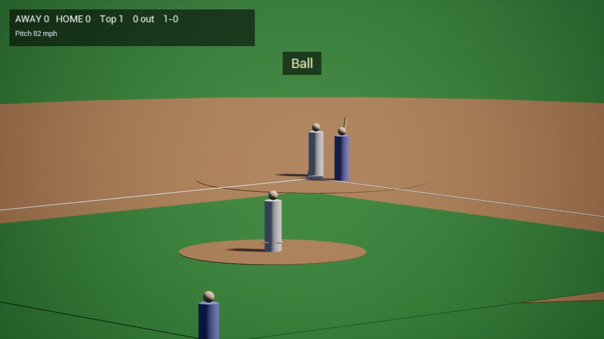
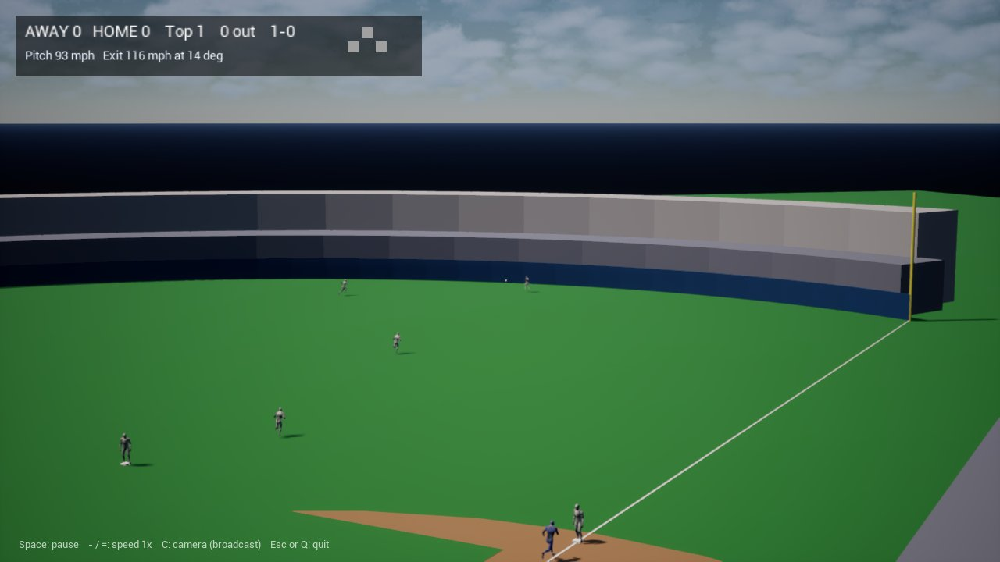

# Unreal spike (M0.8) and client v0: result, 2026-11-11

**Result: every check that could be run unattended passes.** Unreal Engine 5.8.4 (Epic's precompiled Linux build) runs on Fedora with 14 GiB of RAM and the Radeon RX 6700S, loads the Rust sim through the C ABI, and plays full AI-vs-AI games with capsule players, rendered offscreen. The game subsequently ran in a desktop window and the owner watched the spectator build. The editor’s desktop play loop and formal D6 sign-off are tracked in [TASKS.md](../TASKS.md).




## Measurements

| PLAN §3.3 criterion | Measured |
|---|---|
| Plays a capsule timeline at ≥ 60 fps | 290–310 fps at 1280×720, rendered offscreen (Vulkan, RADV). Worst single frame after warm-up 110–130 ms (a hitch, not sustained) |
| Incremental C++ rebuild in a few minutes or less, without running out of memory | 6 s after a one-file edit, 0.65 GB peak. First build of the module: 50 s, 2.1 GB peak |
| Edit → compile → play without sustained heavy swapping | Game process peaks at 2.4 GB; start to first frame about 12 s. No swapping attributable to it |
| Editor opens | Headless editor launch initializes in about 17 s and peaks at 3.5 GB over 2.5 minutes. **Not checked:** the editor's window on the desktop (nobody was at the machine) |

Build parallelism is capped at 6 actions in `~/.config/Unreal Engine/UnrealBuildTool/BuildConfiguration.xml`. Nothing was installed on the host: the engine brings its own .NET and clang.

## Spike build

- `client/`: a C++-only Unreal project. **No binary assets**, so Git LFS is still not needed. The field (grass, infield dirt, mound, bases, foul lines and poles, the outfield wall on the sim's fence curve) is built at start-up from the engine's basic shapes; players are a cylinder and a sphere each, colored by team; the ball was enlarged for visibility.
- The sim is loaded at run time (`libbb_ffi.so`, `client/Source/BaseballClient/BbSim.cpp`) and runs on a worker thread, one pitch ahead of what is on screen. Since 2026-11-13 the first pitch does too: the park stands empty, the scoreboard reading "Warming up", until the worker has it. The client decides nothing about the game.
- `client/Source/BaseballClient/BbFrame.h` is the only place sim coordinates become Unreal coordinates (`ue = 100 × (y, x, z)`).
- A text scoreboard (score, inning, outs, count, pitch speed, exit speed and launch angle).
- Sim side (`bdd1e43`): timelines carry the realized ball (fielded, held, thrown) and a root track for every fielder, runner and the batter; `bb_timeline_info` and `bb_timeline_sample` let a client play a timeline without a FlatBuffers parser.

## Running it

```bash
client/run.sh            # builds the sim library and the client, plays seed 7 in a window
client/run.sh 11 -BbSpeed=2
```

Unattended: add `-RenderOffscreen -BbShots=6` (screenshots to the generated Shots folder, then quit) or `-RenderOffscreen -BbBenchSeconds=60` (logs a `BB_RESULT` line with frame rate and memory, then quits). `-BbStagingLog` adds a line per reset (`BB_RESET`), per player who walks off (`BB_EXIT`, with how far short of his dugout he was when removed) and per throw (`BB_THROW`, with the clip time first drawn, or `MISSED`), and a `BB_STAGING` count at the end; `exits_cut` should be 0. `-BbClipSpeeds` logs the ground speed each gait clip is animated for (`BB_CLIP`: how far its root bone travels per loop, with how fast its planted feet pass under the root and slide), to match staging speeds and play rates to the clips. The engine is expected at `~/UnrealEngine/5.8.4` (`UE_ROOT` overrides).

## Added after the spike (same day)

- A line of play-by-play for every pitch ("Called strike", "Ground out to short", "Double to right, 1 run scores"), built in the sim (`bb_game::describe`) and shown when the viewer would know it.
- The bat: the executed swing is in the timeline and the client draws it; the batter stands in his box until contact.
- Two cameras cut like a broadcast: the pitch from beyond center field through a long lens, the play from high behind home following the ball.

- Stands as plain blocks, a runners-on diamond, and keys: Space pauses, `-` and `=` change speed, C cycles cameras (broadcast, behind home, overhead).
- Run in a window on the desktop (`client/run.sh 7 -BbBenchSeconds=25`): 328 fps at 1600×900, worst frame 7.5 ms.

- After the owner's first watch: human figures (the engine's mannequin, copied into the client’s generated Content folder by `client/run.sh`, with idle, walk and jog picked by speed, facing, and a team tint), and Esc or Q to quit.

## Current client

- [Park](park-visuals.md), [player visuals](player-visuals.md) and [HUD](hud.md) document the generated stadium, coded motions and presentation. The sim exports the park via `bb_game_park` and the line score via `bb_game_box_score`.
- `client/Source/BaseballClient/BbDirector.cpp` stages resets and changes of sides, keeps the ball with its holder, cuts away at dead balls and switches to the center-field view for home-run trots. Space pauses, C cycles cameras, R and F step through instant replays, Enter fast-forwards to the next pitch, and Esc or Q quits. Keys 1–5 set 1×, 2×, 4×, 6× and 10×. Minus and equals adjust by 0.25×.
- The ball’s drawn scale is 1.5625× (`BallDrawnScale` in `client/Source/BaseballClient/BbDirector.h`). Its ground shadow helps show where a fly is coming down.
- `client/Source/BaseballClient/BbSim.cpp` reads FlatBuffers timelines through the C ABI’s summary and frame samplers. See data-formats §6.4 for the interface.
