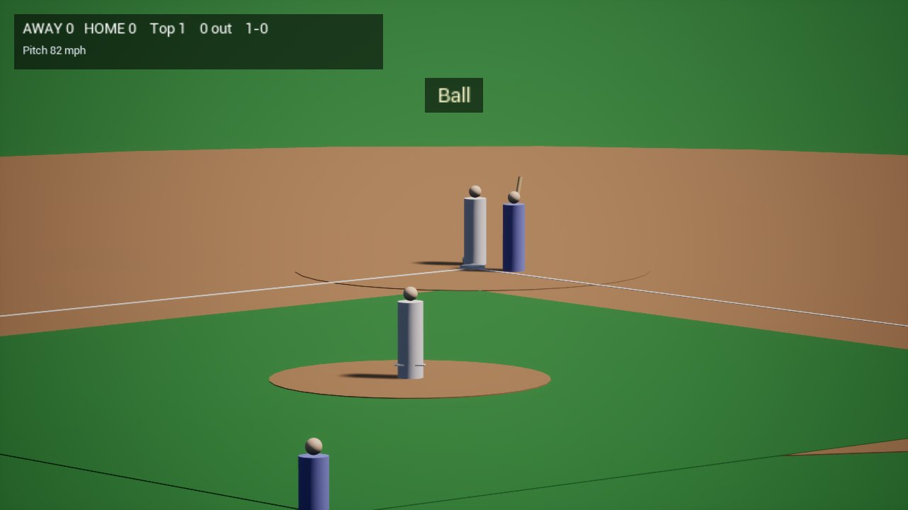
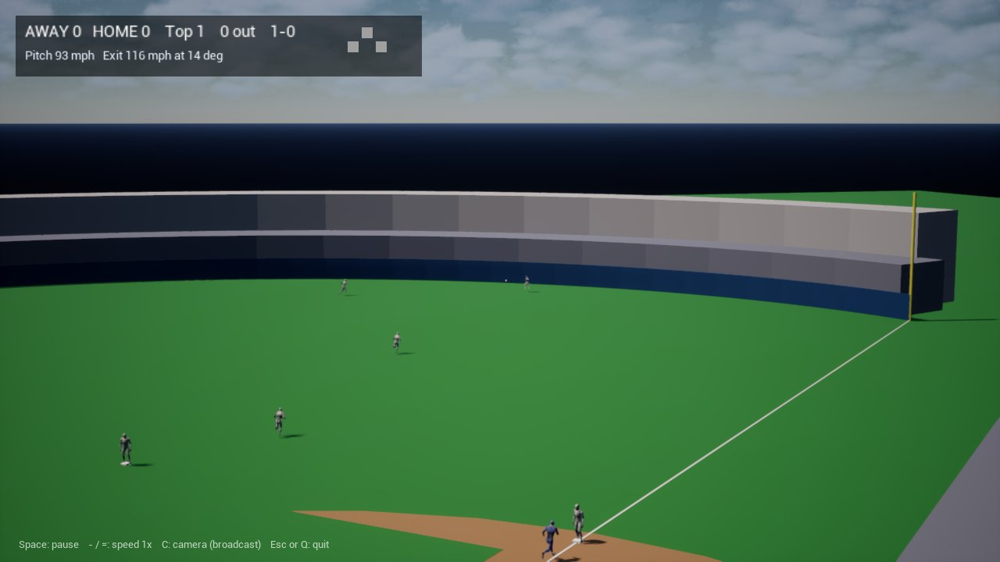

# Unreal spike (M0.8) and client v0: result, 2026-11-11

**Result: every check that could be run unattended passes.** Unreal Engine 5.8.4 (Epic's precompiled Linux build) runs on Fedora with 14 GiB of RAM and the Radeon RX 6700S, loads the Rust sim through the C ABI, and plays full AI-vs-AI games with capsule players, rendered offscreen. Two parts of the PLAN §3.3 gate are still open and need someone at the machine: opening the editor's window and playing in it, and the owner's judgment of how it looks (M0.9). D6 (Unreal as the presentation engine) should be confirmed after that.




## Measurements

| PLAN §3.3 criterion | Measured |
|---|---|
| Plays a capsule timeline at ≥ 60 fps | 290–310 fps at 1280×720, rendered offscreen (Vulkan, RADV). Worst single frame after warm-up 110–130 ms (a hitch, not sustained) |
| Incremental C++ rebuild in a few minutes or less, without running out of memory | 6 s after a one-file edit, 0.65 GB peak. First build of the module: 50 s, 2.1 GB peak |
| Edit → compile → play without sustained heavy swapping | Game process peaks at 2.4 GB; start to first frame about 12 s. No swapping attributable to it |
| Editor opens | Headless editor launch initializes in about 17 s and peaks at 3.5 GB over 2.5 minutes. **Not checked:** the editor's window on the desktop (nobody was at the machine) |

Build parallelism is capped at 6 actions in `~/.config/Unreal Engine/UnrealBuildTool/BuildConfiguration.xml`. Nothing was installed on the host: the engine brings its own .NET and clang.

## What was built

- `client/`: a C++-only Unreal project. **No binary assets**, so Git LFS is still not needed. The field (grass, infield dirt, mound, bases, foul lines and poles, the outfield wall on the sim's fence curve) is built at start-up from the engine's basic shapes; players are a cylinder and a sphere each, colored by team; the ball is drawn three times its real size.
- The sim is loaded at run time (`libbb_ffi.so`, `BbSim.cpp`) and runs on a worker thread, one pitch ahead of what is on screen. The client decides nothing about the game.
- `BbFrame.h` is the only place sim coordinates become Unreal coordinates (`ue = 100 × (y, x, z)`).
- A text scoreboard (score, inning, outs, count, pitch speed, exit speed and launch angle).
- Sim side (`bdd1e43`): timelines carry the realized ball (fielded, held, thrown) and a root track for every fielder, runner and the batter; `bb_timeline_info` and `bb_timeline_sample` let a client play a timeline without a FlatBuffers parser.

## Running it

```bash
client/run.sh            # builds the sim library and the client, plays seed 7 in a window
client/run.sh 11 -BbSpeed=2
```

Unattended: add `-RenderOffscreen -BbShots=6` (screenshots to `client/Saved/Shots`, then quit) or `-RenderOffscreen -BbBenchSeconds=60` (logs a `BB_RESULT` line with frame rate and memory, then quits). The engine is expected at `~/UnrealEngine/5.8.4` (`UE_ROOT` overrides).

## Added after the spike (same day)

- A line of play-by-play for every pitch ("Called strike", "Ground out to short", "Double to right, 1 run scores"), built in the sim (`bb_game::describe`) and shown when the viewer would know it.
- The bat: the executed swing is in the timeline and the client draws it; the batter stands in his box until contact.
- Two cameras cut like a broadcast: the pitch from beyond center field through a long lens, the play from high behind home following the ball.

## Known gaps in v0

- Players are capsules that slide: no facing, no throwing or catching motion, no pitcher's delivery.
- Between pitches everyone snaps back to his starting spot; the ball is not returned to the pitcher.
- The scoreboard has no names, no runners-on display, no line score.
- The ball is hard to see on deep flies.
- The park dimensions are repeated in the client (`BbDirector.cpp`) instead of coming from the sim.
- The client samples through C structs. The spec's plan (data-formats §6.4) is for the client to read the FlatBuffers timeline directly; the sampler is a deliberate shortcut and the timeline blob is still the only data crossing the boundary.
